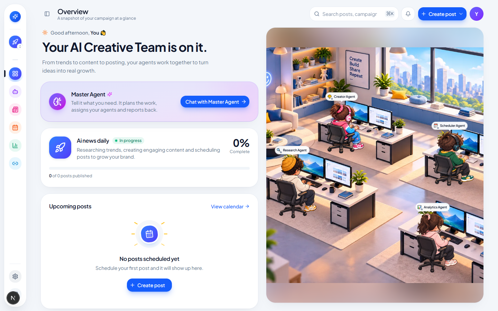
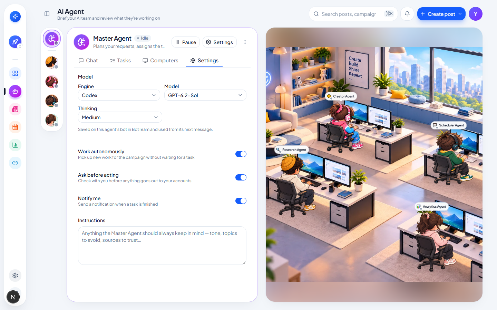
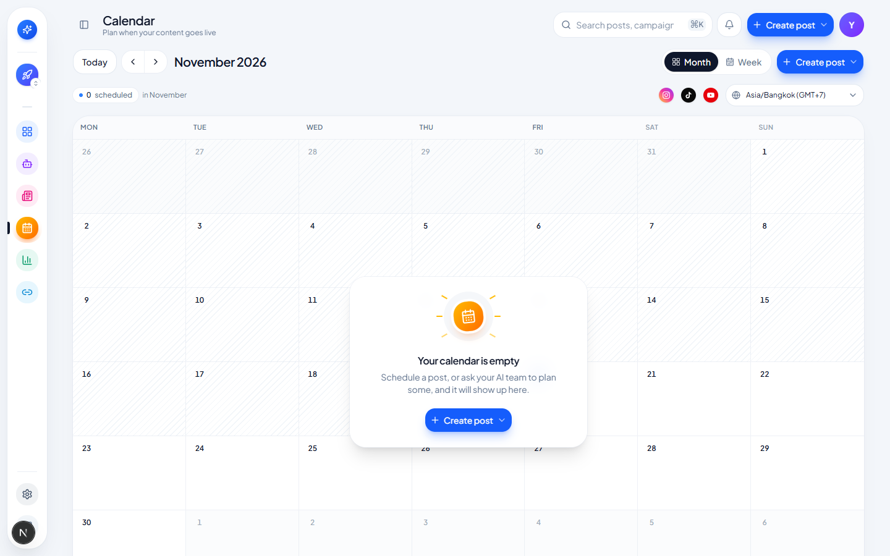
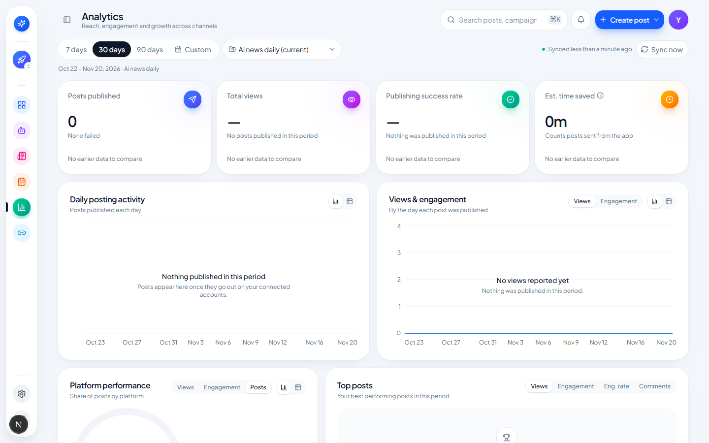
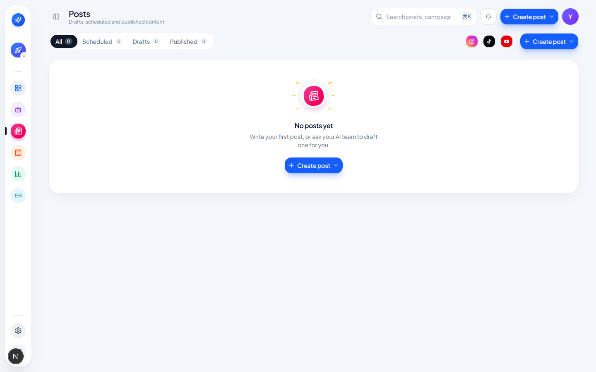
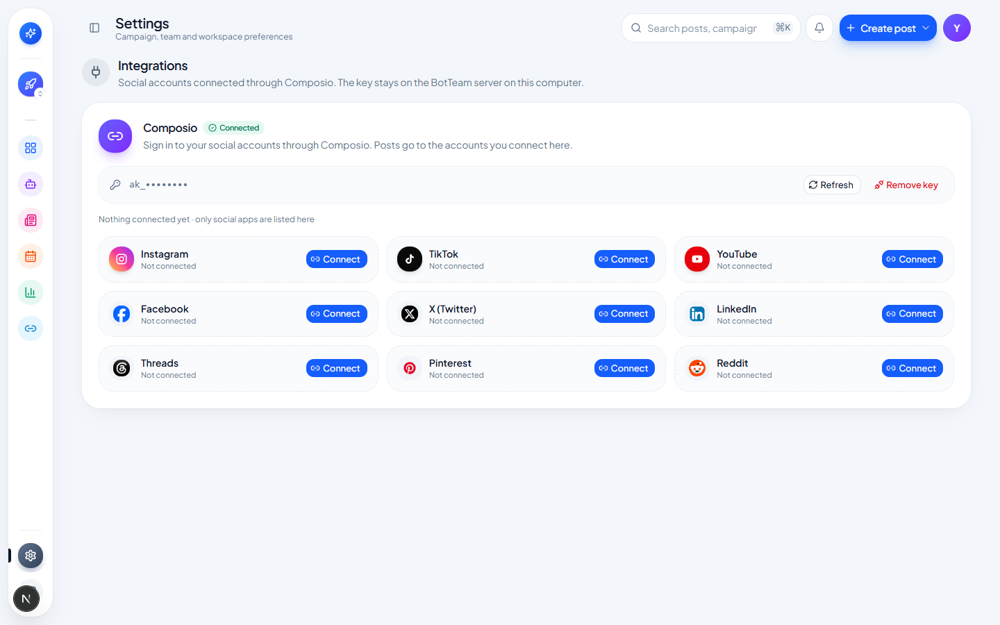
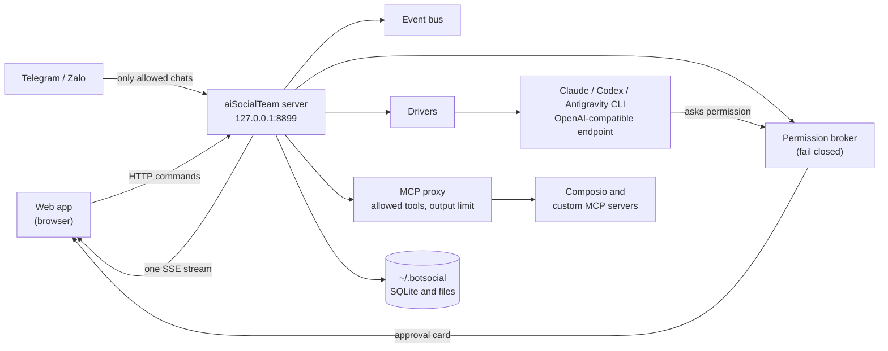

# **aiSocialTeam**

aiSocialTeam is a local chat app where every contact in the sidebar is a real AI agent: the Claude Code, Codex or Antigravity CLI (or any OpenAI-compatible endpoint) running on your computer, with its own name, instructions, model, memory and connected apps. Bots work together in channels, hand tasks to each other, run on a schedule, and answer people who write to them on Telegram or Zalo. Everything is kept on your machine.

The web app is a social-media dashboard: you create a campaign and get an AI team of five bots (Master, Research, Creator, Scheduler, Analytics) that you brief in chat, with posts, a calendar, analytics and social accounts connected through Composio next to them. The interface is in English and Vietnamese: the Language button just above Settings at the bottom of the sidebar picks the language.

It is built with a Next.js web app and a Python (FastAPI) server, and is inspired by [OpenMausBot](https://github.com/milind-soni/OpenMausBot).

**English** | [Tiếng Việt](docs/user-guide.md)

---

<p align="center"></p>

<table>
  <tr>
    <td width="33%"></td>
    <td width="33%"></td>
    <td width="33%"></td>
  </tr>
  <tr>
    <td width="33%"></td>
    <td width="33%"></td>
    <td width="33%"></td>
  </tr>
</table>

---

## ⚡ Quick Start

**macOS / Linux**

```bash
curl -fsSL https://raw.githubusercontent.com/jokerhung/aiSocialTeam/master/install.sh -o install.sh && bash install.sh
```

**Windows (PowerShell)**

```powershell
iwr -useb https://raw.githubusercontent.com/jokerhung/aiSocialTeam/master/install.ps1 -OutFile install.ps1; powershell -ExecutionPolicy Bypass -File install.ps1
```

The script installs Git, Node.js, Python and uv when they are missing, clones the repository and installs its dependencies. Add `--claude` / `-Claude`, `--codex` / `-Codex` or `--antigravity` / `-Antigravity` to install the engine CLIs too. See [docs/user-guide.md](docs/user-guide.md) for every option and for signing in to an engine.

---

## ✨ 8 Superpowers

- 🤖 **Real agents, not a chat wrapper** — each bot is a Claude Code, Codex or Antigravity CLI session (or an OpenAI-compatible endpoint) with its own model, working folder and approval level.
- 👥 **Teams and channels** — put several bots in one channel, `@mention` them, and let a bot hand work to another one.
- ✋ **Approval cards** — before a bot runs a command, edits a file or sends something out, you decide in the chat: Ask, Edits, Auto or Full.
- 🔌 **Connected apps** — connect Gmail, Google Sheets, Slack, GitHub and more through Composio, or add your own MCP servers.
- 💬 **Telegram and Zalo input** (Telegram bot, Zalo bot, or your own Zalo account through a Node.js service) — a bot answers every message, or collects photos and files and runs by itself after 30 quiet seconds (or when someone presses *Check*). How a bot receives messages is written in an `intake.md` in its working folder, which you can edit in Bot settings: progress messages while photos arrive, saving them into folders such as `<machine>/<date>/Truoc|Sau` read from the caption (identical files are not saved twice), and a short reply with or without running a bot. Each batch of photos gets its own conversation in the app that also shows everything sent to the chat, and `run.command` can run a script of the working folder afterwards (for example to download PDFs), retrying until it succeeds.
- 🌐 **Browser use** — each campaign agent browses in its own Edge or Chrome profile through Playwright MCP. Watch its Browser tab, take over for sign-in or CAPTCHA, then hand control back.
- ⏰ **Automations** — schedules (routines) and webhooks start a bot without you, with a calendar page to see them.
- 🧠 **Memory, skills and sharing** — notes that last between tasks, `SKILL.md` skills, and one-file export and import of a bot or a team.

---

## 🛡️ Security Architecture



- **Local first.** The server listens on `127.0.0.1`. Localhost, LAN and Tailscale addresses open directly; a domain or public address needs a one-time pairing code (valid 10 minutes).
- **Fail closed.** A permission request that nobody answers is denied.
- **Keys are write-only.** The app only shows that a key is configured. Composio, Telegram and Zalo tokens stay on this machine and never appear in an exported bot file.
- **Outside text is data.** Text from tools, web pages, chats and photo captions is never treated as an instruction.
- **Bounded access.** Bots cannot open internal addresses (localhost, private networks) unless you allow it; each connection can be limited to read or write and to a list of allowed tools; sending out always asks unless you say otherwise.

---

## 📂 Project Structure (Monorepo)

| Path | Purpose |
|---|---|
| `web/` | Next.js (App Router) social-media dashboard (SocialTeam look: overview, AI Agent office and chat, posts, calendar, analytics, accounts), React, Tailwind v4. Pages read the server in `server/botteam` from the Next.js side (`BOTTEAM_API`, default `http://127.0.0.1:8899`) |
| `web/lib/` | `botteam.ts` (server client), `campaigns.ts`, `posts/`, `analytics/`, `agent-chats.ts`: the data layer over `/api/social/*` and the bots' chat |
| `server/botteam/social.py` | Campaigns (each creates a team of five bots: Master, Research, Creator, Scheduler, Analytics), posts and analytics for the dashboard; stored in the same SQLite file |
| `server/botteam/` | FastAPI server: `main.py` (routes), `turns.py`, `registry.py`, `broker.py`, `store.py`, `routines.py`, `memory.py` |
| `server/botteam/drivers/` | One driver per engine: `claude.py`, `codex.py`, `antigravity.py`, `openai_compat.py` |
| `server/botteam/channels/` | Telegram, Zalo bot and Zalo personal-account input, batch and chat modes |
| `zalo-service/` | Node.js service on [zca-js](https://github.com/RFS-ADRENO/zca-js): QR sign-in, receives and sends Zalo messages for a personal account; reached through the `/zalo-api` proxy in `web/next.config.mjs` |
| `server/botteam/mcp_*.py`, `composio.py` | MCP servers, proxy and Composio connection |
| `server/tests/` | pytest suites (a fake driver replays events) |
| `scripts/` | Helpers: `run.mjs`, `free-ports.ps1`, visual and reference checks |
| `docs/` | Phase plans, [user guide](docs/user-guide.md), visual report, [examples](docs/examples/) of `intake.md` and `machines.md` |
| `specs/` | Specs of changes, such as [intake.md](specs/intake-md.md) |
| `workspaces/` | Working folders aiSocialTeam makes for bots that were given none (created at run time, not in git) |
| `install.ps1`, `install.sh`, `start.bat`, `zip-project.ps1` | Install, start and pack scripts |

### Development Setup

#### Prerequisites

- Python 3.10 or newer and [uv](https://docs.astral.sh/uv/)
- Node.js 20 or newer and pnpm
- Git
- At least one engine: the Claude Code CLI, the Codex CLI, the Antigravity CLI (`agy`, from antigravity.google), or an OpenAI-compatible endpoint
- Microsoft Edge or Chrome for Browser use. Without either one, run `uv run --project server playwright install chromium`.
- Node.js 20+ and `npx` for Playwright MCP. The installers prefetch the pinned package.

Browser use tries Edge, Chrome and then Playwright Chromium. Each bot's sign-ins are kept in its own profile under `<data>/browser/`. aiSocialTeam excludes browser profiles from backup and bot export. See `.env.example` for browser selection, window visibility and idle timeout.

#### Computer use with E2B or OpenSandbox

Computer use is optional and off by default. It requires Python 3.11 or later and a computer host that you set up yourself: **E2B Cloud**, a **self-hosted E2B** server (Linux with KVM), or an **OpenSandbox** server on any Linux machine with Docker (each computer is a container; no KVM needed). Configure it in **Settings → Computer Use**. After the connection passes, choose **Computer use**, **Browser use**, or **Off** for each campaign agent.

E2B Cloud processes the virtual machine's contents and screenshots on its own infrastructure under the limits and prices of your E2B plan. With self-hosted E2B, those stay on your host and aiSocialTeam relays the display. See the E2B setup guide ([English](docs/e2b-setup.en.md), [Vietnamese](docs/e2b-setup.vi.md)) or the OpenSandbox setup guide ([English](docs/opensandbox-setup.en.md), [Vietnamese](docs/opensandbox-setup.vi.md)); the OpenSandbox desktop image is built from [docs/opensandbox-desktop](docs/opensandbox-desktop). OpenSandbox containers are held back only by Docker unless you turn on gVisor or Kata, and an idle computer is frozen or removed instead of snapshotted, so open windows and sign-ins may not survive.

In **AI Agent → Settings → Browser**, choose which browser to run and whether the agent publishes through Composio (the default) or its web browser. Use **Clear browser data** to remove that agent's cookies and sign-ins. Browser access to local addresses and downloads is off by default.
- Optional, for pictures: the Codex CLI (`install.ps1 -Codex` / `install.sh --codex`, then `codex login`) or the Gemini CLI. In the Creator agent's **Settings → Image generation** choose which one makes the images (post editor's *Generate with AI* and the Creator's `POST /api/social/images`); no image API key is needed. Gemini CLI makes images only with an image extension installed. Pictures are kept in `<data folder>/social-media`.

The install scripts check all of this and install what is missing. Ports (set in `.env`): web `5499`, API `9999`, webhooks `9900`. The Zalo service (`8902`) is not started by `pnpm dev`; run `pnpm dev:zalo` when you need it.

#### Windows — PowerShell

**Quick start:**

```powershell
powershell -ExecutionPolicy Bypass -File install.ps1
.\start.bat
```

**Run one part only:**

```powershell
.\start.bat server   # the API server, with reload
.\start.bat web      # the web app
.\start.bat one      # the API (botteam serve) only: the web app renders on Node.js, so start it with `pnpm start:web` after `pnpm build:static`
```

`start.bat` frees its ports first, then starts. If `pnpm` or `uv` is not found right after the install, open a new terminal window.

#### macOS

```bash
bash install.sh
pnpm dev
```

`pnpm dev` starts the server and the web app together. Open a new terminal if `uv` or `pnpm` is not recognized after the install.

#### Linux

```bash
bash install.sh      # uses sudo when you are not root
pnpm dev
```

To use aiSocialTeam from another computer on your LAN or Tailscale, keep `WEB_HOST=0.0.0.0` in `.env` (the default), keep `SERVER_HOST=127.0.0.1`, restart, and open `http://<ip>:5499`. The web app (`web/proxy.ts`) only answers on localhost, LAN and Tailscale IPs; a domain name such as a MagicDNS name must be listed in `WEB_ALLOWED_HOSTS`. There is no sign-in, so anyone on those networks can use it: set `WEB_HOST=127.0.0.1` to keep it to this computer.

#### Open the application and configure it

1. Open `http://127.0.0.1:5499` in development (the server must be running: `pnpm dev` starts both). The first visit asks you to create a campaign, which makes its five bots; the web app is started by `pnpm dev` (or `pnpm build:static` then `pnpm start:web`).
   > The dashboard does not publish to any social network yet: a scheduled post is marked published locally when its time passes, the platforms a post can go to are the social apps Composio lists (its "social media accounts" category: twitter, instagram, tiktok, youtube, facebook…, read from Composio, not fixed in the code) and accounts are connected through it (Settings → Integrations; the key is the server's `COMPOSIO_API_KEY` or one pasted there) but nothing posts through them yet, and post metrics are entered through `PUT /api/social/posts/{id}/metrics`.
2. The welcome screen checks for an engine. Install and sign in (`claude`, `codex login`, `agy`) or add an OpenAI-compatible endpoint in Settings → Engines, then press **Check again**.
3. Press **+** → **New bot**, name it and pick a color.
4. Choose the bot's approval level, and connect apps with **Connect apps** (Composio key, custom MCP servers, Telegram and Zalo input). A bot you make without a working folder gets `workspaces/<bot id>/`; when it is given an input, an `intake.md` is made there (Bot settings → *Intake workflow* edits it).

> ⚠️ A bot on **Full** approval can run any command on your computer. Use **Ask** for any bot that talks to people outside your team.

#### Build packages and run checks

```bash
pnpm test              # server (pytest), the web app's language checks (scripts/check-i18n.mjs, scripts/i18n.test.mjs) and the Zalo service (node:test)
pnpm typecheck         # TypeScript
pnpm --filter web build  # production build of the web app, then `pnpm start:web`
```

Your data lives in the folder set by `BOTTEAM_DATA_DIR` in `.env` (default `~/.botsocial`, that is `%USERPROFILE%\.botsocial` on Windows), apart from any other aiSocialTeam on the same computer. The server, the web app and the Zalo service all read this one setting; change it to keep the data elsewhere (`~`, `%VAR%` and `$VAR` are expanded) and restart. Back it up with Settings → Backup or `botteam backup <file>`. The plan, scope and risks are in [docs/README.md](docs/README.md).

---

## 📄 License

aiSocialTeam does not have its own license file yet. Third-party notices are in [NOTICE](NOTICE).

- Repository: <https://github.com/jokerhung/aiSocialTeam>
