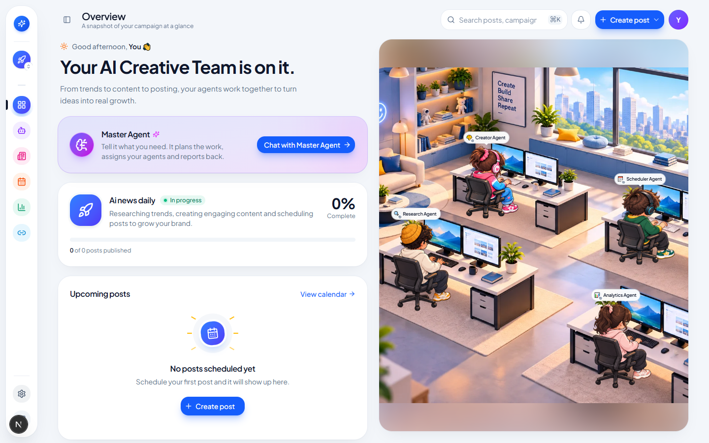
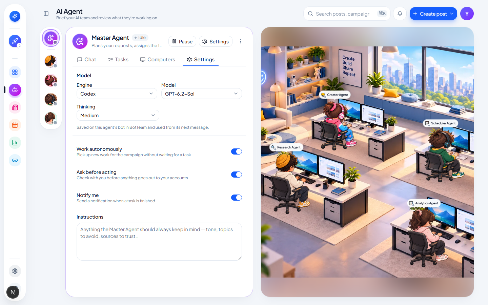
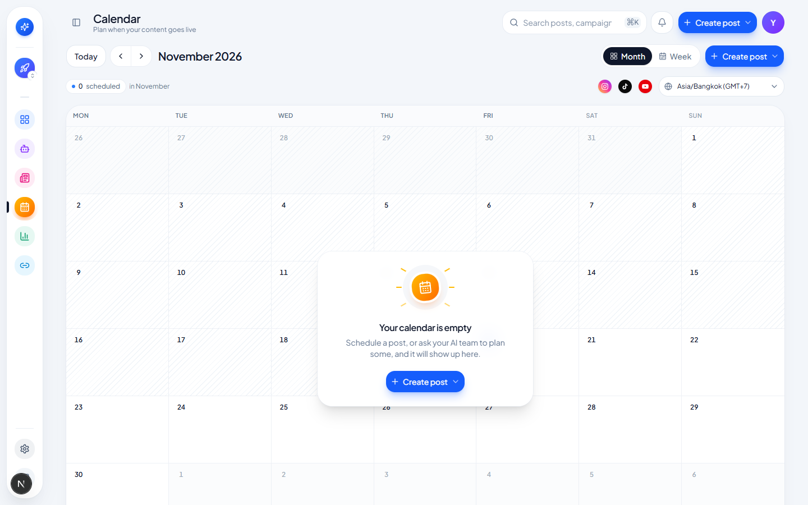
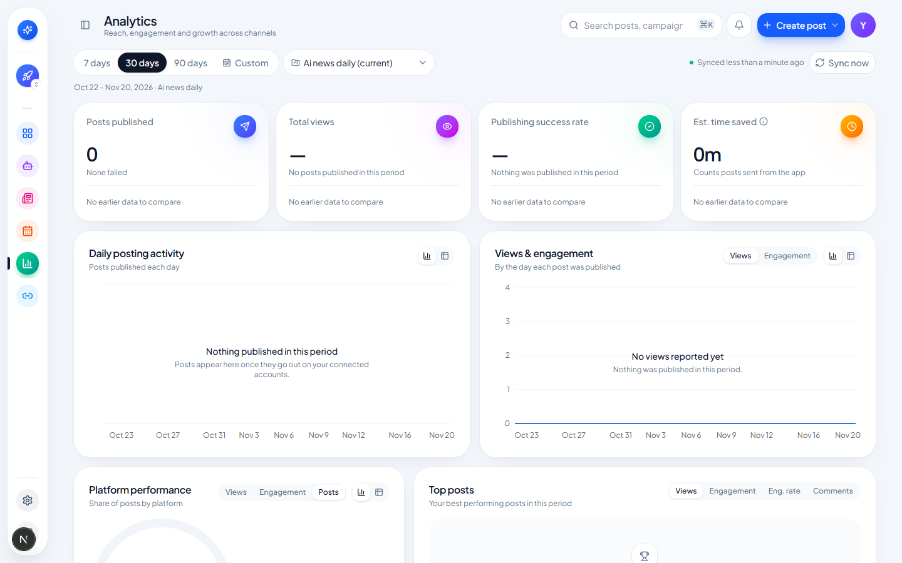
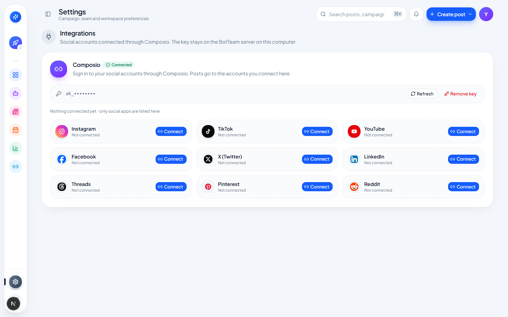
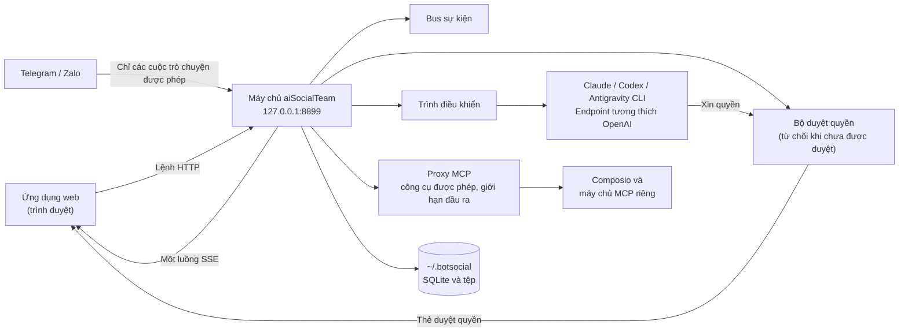

# **aiSocialTeam**

aiSocialTeam là ứng dụng đa tác tử để tạo nội dung mạng xã hội. Biến yêu cầu ban đầu thành quy trình phối hợp giữa năm AI agent: Master lập kế hoạch và phân công, Research tìm chủ đề và nguồn tham khảo, Creator viết chú thích và chuẩn bị hình ảnh, Scheduler sắp xếp lịch nội dung, còn Analytics hỗ trợ đánh giá hiệu quả. Trò chuyện với cả đội để phát triển ý tưởng, hoàn thiện bản nháp và chuẩn bị nội dung cho các chiến dịch.

Mỗi agent có thể dùng Claude Code, Codex hoặc Antigravity CLI, hoặc endpoint tương thích OpenAI, với hướng dẫn, mô hình, bộ nhớ, thư mục làm việc và ứng dụng kết nối riêng. Các agent có thể giao việc cho nhau, chạy theo lịch và nhận yêu cầu qua Telegram hoặc Zalo. Dashboard tập hợp cuộc trò chuyện của chiến dịch, bài đăng, lịch, phân tích và tài khoản mạng xã hội kết nối qua Composio. Dữ liệu chiến dịch và cuộc trò chuyện được lưu trên máy tính của bạn. Giao diện hỗ trợ tiếng Anh và tiếng Việt, chọn bằng nút ngôn ngữ phía trên Cài đặt ở cuối thanh bên.

Ứng dụng được xây dựng bằng Next.js và máy chủ Python (FastAPI), lấy cảm hứng từ [video này](https://www.youtube.com/watch?v=5GWTDRrwynY).

[English](README.md) | **Tiếng Việt**

---

<p align="center"></p>

<table>
  <tr>
    <td width="33%"></td>
    <td width="33%"></td>
    <td width="33%"></td>
  </tr>
  <tr>
    <td width="33%"></td>
    <td width="33%"></td>
    <td width="33%"></td>
  </tr>
</table>

---

## ⚡ Bắt đầu nhanh

**macOS / Linux**

```bash
curl -fsSL https://raw.githubusercontent.com/jokerhung/aiSocialTeam/master/install.sh -o install.sh && bash install.sh
```

**Windows (PowerShell)**

```powershell
iwr -useb https://raw.githubusercontent.com/jokerhung/aiSocialTeam/master/install.ps1 -OutFile install.ps1; powershell -ExecutionPolicy Bypass -File install.ps1
```

Script cài Git, Node.js, Python và uv nếu còn thiếu, sao chép repository và cài các thư viện phụ thuộc. Thêm `--claude` / `-Claude`, `--codex` / `-Codex` hoặc `--antigravity` / `-Antigravity` để cài thêm CLI của engine. Xem đầy đủ tuỳ chọn và cách đăng nhập engine trong [hướng dẫn sử dụng](docs/user-guide.md).

---

## ✨ 8 tính năng nổi bật

- 🤖 **Agent thực thụ** — mỗi bot là một phiên Claude Code, Codex hoặc Antigravity CLI, hoặc kết nối tới endpoint tương thích OpenAI, với mô hình, thư mục làm việc và mức duyệt quyền riêng.
- 👥 **Đội nhóm và kênh** — đưa nhiều bot vào cùng kênh, gọi tên bằng `@mention` và cho phép bot giao việc cho nhau.
- ✋ **Thẻ duyệt quyền** — trước khi bot chạy lệnh, sửa tệp hoặc gửi nội dung ra ngoài, bạn quyết định ngay trong cuộc trò chuyện theo các mức Ask, Edits, Auto hoặc Full.
- 🔌 **Ứng dụng kết nối** — kết nối Gmail, Google Sheets, Slack, GitHub và nhiều ứng dụng khác qua Composio, hoặc thêm máy chủ MCP riêng.
- 💬 **Nhận dữ liệu từ Telegram và Zalo** — hỗ trợ Telegram bot, Zalo bot hoặc tài khoản Zalo cá nhân qua dịch vụ Node.js. Bot có thể trả lời từng tin nhắn hoặc thu thập ảnh, tệp rồi tự chạy sau 30 giây không có dữ liệu mới, hoặc khi người dùng bấm *Check*. Quy trình nhận dữ liệu nằm trong tệp `intake.md` ở thư mục làm việc, có thể chỉnh trong cài đặt bot. Quy trình gồm thông báo tiến độ khi nhận ảnh, lưu vào thư mục như `<machine>/<date>/Truoc|Sau` theo chú thích, tránh lưu trùng tệp và trả lời ngắn có hoặc không chạy bot. Mỗi đợt ảnh có cuộc trò chuyện riêng trong ứng dụng, hiển thị cả nội dung đã gửi tới kênh chat. Sau đó, `run.command` có thể chạy script trong thư mục làm việc, chẳng hạn để tải PDF, và thử lại cho đến khi thành công.
- 🌐 **Dùng trình duyệt** — mỗi agent của chiến dịch có hồ sơ Edge hoặc Chrome riêng, điều khiển qua Playwright MCP. Xem tab Browser, tiếp quản để đăng nhập hoặc xử lý CAPTCHA, rồi trả quyền cho agent.
- ⏰ **Tự động hoá** — lịch chạy định kỳ và webhook khởi động bot tự động, có trang lịch để theo dõi.
- 🧠 **Bộ nhớ, kỹ năng và chia sẻ** — ghi chú được giữ qua nhiều tác vụ, kỹ năng `SKILL.md`, xuất và nhập bot hoặc đội bằng một tệp.

---

## 🛡️ Kiến trúc bảo mật



- **Ưu tiên cục bộ.** Máy chủ lắng nghe tại `127.0.0.1`. Truy cập trực tiếp qua localhost, LAN và Tailscale. Tên miền hoặc địa chỉ công khai cần mã ghép nối dùng một lần, có hiệu lực 10 phút.
- **Mặc định từ chối.** Yêu cầu quyền không được ai trả lời sẽ bị từ chối.
- **Khoá chỉ cho phép ghi.** Ứng dụng chỉ cho biết khoá đã được cấu hình. Token Composio, Telegram và Zalo được giữ trên máy và không xuất hiện trong tệp xuất bot.
- **Nội dung bên ngoài là dữ liệu.** Văn bản từ công cụ, trang web, tin nhắn và chú thích ảnh không được xem là chỉ dẫn.
- **Giới hạn truy cập.** Bot chỉ mở được địa chỉ nội bộ như localhost và mạng riêng khi bạn cho phép. Mỗi kết nối có thể được giới hạn quyền đọc, ghi và danh sách công cụ. Việc gửi nội dung ra ngoài luôn cần duyệt trừ khi bạn cấu hình khác.

---

## 📂 Cấu trúc dự án (monorepo)

| Đường dẫn | Chức năng |
|---|---|
| `web/` | Bảng điều khiển mạng xã hội Next.js (App Router) theo giao diện SocialTeam, gồm tổng quan, văn phòng AI Agent và trò chuyện, bài đăng, lịch, phân tích, tài khoản. Sử dụng React và Tailwind v4. Các trang đọc máy chủ trong `server/botteam` từ phía Next.js qua `BOTTEAM_API`, mặc định `http://127.0.0.1:8899`. |
| `web/lib/` | `botteam.ts` (kết nối máy chủ), `campaigns.ts`, `posts/`, `analytics/`, `agent-chats.ts`, tạo lớp dữ liệu cho `/api/social/*` và trò chuyện với bot. |
| `server/botteam/social.py` | Chiến dịch, bài đăng và phân tích cho dashboard. Mỗi chiến dịch tạo năm bot Master, Research, Creator, Scheduler, Analytics. Dữ liệu nằm trong cùng tệp SQLite. |
| `server/botteam/` | Máy chủ FastAPI gồm `main.py` (route), `turns.py`, `registry.py`, `broker.py`, `store.py`, `routines.py`, `memory.py`. |
| `server/botteam/drivers/` | Trình điều khiển riêng cho từng engine, gồm `claude.py`, `codex.py`, `antigravity.py`, `openai_compat.py`. |
| `server/botteam/channels/` | Nhận dữ liệu qua Telegram, Zalo bot và tài khoản Zalo cá nhân, hỗ trợ chế độ theo đợt và trò chuyện. |
| `zalo-service/` | Dịch vụ Node.js dùng [zca-js](https://github.com/RFS-ADRENO/zca-js), đăng nhập bằng QR, nhận và gửi tin nhắn bằng tài khoản Zalo cá nhân. Truy cập qua proxy `/zalo-api` trong `web/next.config.mjs`. |
| `server/botteam/mcp_*.py`, `composio.py` | Máy chủ MCP, proxy và kết nối Composio. |
| `server/tests/` | Các bộ kiểm thử pytest, dùng trình điều khiển giả để phát lại sự kiện. |
| `scripts/` | Script hỗ trợ như `run.mjs`, `free-ports.ps1`, kiểm tra giao diện và bản tham chiếu. |
| `docs/` | Kế hoạch từng giai đoạn, [hướng dẫn sử dụng](docs/user-guide.md), báo cáo giao diện và [ví dụ](docs/examples/) về `intake.md`, `machines.md`. |
| `specs/` | Đặc tả thay đổi, chẳng hạn [intake.md](specs/intake-md.md). |
| `workspaces/` | Thư mục làm việc aiSocialTeam tạo cho bot chưa được chỉ định thư mục. Được tạo lúc chạy và không nằm trong git. |
| `install.ps1`, `install.sh`, `start.bat`, `zip-project.ps1` | Script cài đặt, khởi động và đóng gói. |

### Thiết lập môi trường phát triển

#### Yêu cầu

- Python 3.10 trở lên và [uv](https://docs.astral.sh/uv/).
- Node.js 20 trở lên và pnpm.
- Git.
- Ít nhất một engine gồm Claude Code CLI, Codex CLI, Antigravity CLI (`agy`, từ antigravity.google), hoặc endpoint tương thích OpenAI.
- Microsoft Edge hoặc Chrome để dùng trình duyệt. Nếu chưa có cả hai, chạy `uv run --project server playwright install chromium`.
- Node.js 20+ và `npx` để chạy Playwright MCP. Script cài đặt tải trước phiên bản gói đã ghim.

Chế độ dùng trình duyệt ưu tiên Edge, rồi Chrome, sau đó Playwright Chromium. Phiên đăng nhập của mỗi bot được lưu trong hồ sơ riêng tại `<data>/browser/`. aiSocialTeam loại hồ sơ trình duyệt khỏi bản sao lưu và tệp xuất bot. Xem `.env.example` để chọn trình duyệt, bật hiển thị cửa sổ và đặt thời gian chờ.

#### Dùng máy tính với E2B hoặc OpenSandbox

Chế độ dùng máy tính là tính năng tuỳ chọn, mặc định tắt. Tính năng cần Python 3.11 trở lên và máy chủ do bạn tự thiết lập, gồm **E2B Cloud**, **E2B tự host** trên Linux có KVM, hoặc **OpenSandbox** trên máy Linux có Docker. Với OpenSandbox, mỗi máy tính là một container và không cần KVM. Cấu hình tại **Cài đặt → Dùng máy tính**. Sau khi kết nối đạt, chọn **Dùng máy tính**, **Dùng trình duyệt** hoặc **Tắt** cho từng agent trong chiến dịch.

E2B Cloud xử lý nội dung và ảnh màn hình máy ảo trên hạ tầng của E2B, theo giới hạn và giá của gói bạn đăng ký. Với E2B tự host, dữ liệu nằm trên máy chủ của bạn và aiSocialTeam chuyển tiếp màn hình. Xem hướng dẫn E2B ([tiếng Anh](docs/e2b-setup.en.md), [tiếng Việt](docs/e2b-setup.vi.md)) hoặc hướng dẫn OpenSandbox ([tiếng Anh](docs/opensandbox-setup.en.md), [tiếng Việt](docs/opensandbox-setup.vi.md)). Image desktop của OpenSandbox được dựng từ [docs/opensandbox-desktop](docs/opensandbox-desktop). Container OpenSandbox được cách ly bằng Docker, có thể bật thêm gVisor hoặc Kata. Máy tính khi rảnh được đóng băng hoặc xoá thay vì chụp snapshot, nên cửa sổ và phiên đăng nhập có thể không được giữ lại.

Trong **AI Agent → Cài đặt → Trình duyệt**, chọn trình duyệt và cách agent đăng bài qua Composio (mặc định) hoặc trình duyệt web. Dùng **Xoá dữ liệu trình duyệt** để xoá cookie và phiên đăng nhập của agent. Truy cập địa chỉ nội bộ và tải tệp mặc định tắt.

- Tuỳ chọn tạo ảnh bằng Codex CLI (`install.ps1 -Codex` / `install.sh --codex`, rồi `codex login`) hoặc Gemini CLI. Trong **Cài đặt → Tạo ảnh** của Creator, chọn công cụ tạo ảnh cho nút *Tạo bằng AI* ở trình soạn bài và endpoint `POST /api/social/images` của Creator. Không cần khoá API tạo ảnh. Gemini CLI cần cài tiện ích tạo ảnh. Ảnh được lưu tại `<data folder>/social-media`.

Script cài đặt kiểm tra các yêu cầu này và cài phần còn thiếu. Các cổng được đặt trong `.env`, gồm web `5499`, API `9999`, webhook `9900`. Dịch vụ Zalo dùng cổng `8902` và không khởi động cùng `pnpm dev`. Chạy `pnpm dev:zalo` khi cần.

#### Windows — PowerShell

**Khởi động nhanh**

```powershell
powershell -ExecutionPolicy Bypass -File install.ps1
.\start.bat
```

**Chạy từng thành phần**

```powershell
.\start.bat server   # máy chủ API, có tự tải lại khi mã nguồn thay đổi
.\start.bat web      # ứng dụng web
.\start.bat one      # chỉ API (botteam serve), ứng dụng web chạy trên Node.js, dùng pnpm start:web sau pnpm build:static
```

`start.bat` giải phóng các cổng trước khi khởi động. Nếu chưa tìm thấy `pnpm` hoặc `uv` ngay sau khi cài, mở cửa sổ terminal mới.

#### macOS

```bash
bash install.sh
pnpm dev
```

`pnpm dev` khởi động máy chủ và ứng dụng web cùng lúc. Mở terminal mới nếu hệ thống chưa nhận ra `uv` hoặc `pnpm` sau khi cài.

#### Linux

```bash
bash install.sh      # dùng sudo nếu bạn không chạy bằng root
pnpm dev
```

Để dùng aiSocialTeam từ máy khác trong LAN hoặc Tailscale, giữ `WEB_HOST=0.0.0.0` trong `.env` (mặc định), giữ `SERVER_HOST=127.0.0.1`, khởi động lại và mở `http://<ip>:5499`. Ứng dụng web (`web/proxy.ts`) chỉ trả lời trên localhost, IP LAN và Tailscale. Tên miền như MagicDNS cần được thêm vào `WEB_ALLOWED_HOSTS`. Ứng dụng không có bước đăng nhập, nên mọi người trong các mạng này đều có thể dùng. Đặt `WEB_HOST=127.0.0.1` để chỉ dùng trên máy hiện tại.

#### Mở và cấu hình ứng dụng

1. Khi phát triển, mở `http://127.0.0.1:5499`. Máy chủ cần đang chạy, và `pnpm dev` khởi động cả máy chủ lẫn web. Lần đầu truy cập, ứng dụng yêu cầu tạo chiến dịch và tạo năm bot cho chiến dịch đó. Khởi động web bằng `pnpm dev`, hoặc `pnpm build:static` rồi `pnpm start:web`.

   > Dashboard hiện chưa đăng bài thật lên mạng xã hội. Bài đến giờ được đánh dấu đã xuất bản trong dữ liệu cục bộ. Các nền tảng có thể chọn được lấy từ danh mục “social media accounts” của Composio, như twitter, instagram, tiktok, youtube, facebook…, thay vì cố định trong mã. Tài khoản được kết nối qua Composio tại Cài đặt → Tích hợp, dùng `COMPOSIO_API_KEY` của máy chủ hoặc khoá nhập ở đó, nhưng chưa thực hiện đăng bài qua các kết nối này. Chỉ số bài đăng được nhập qua `PUT /api/social/posts/{id}/metrics`.

2. Màn hình chào kiểm tra engine. Cài và đăng nhập bằng `claude`, `codex login`, `agy`, hoặc thêm endpoint tương thích OpenAI trong Cài đặt → Engine, rồi bấm **Kiểm tra lại**.
3. Bấm **+** → **Bot mới**, đặt tên và chọn màu.
4. Chọn mức duyệt quyền và kết nối ứng dụng bằng **Kết nối ứng dụng**, gồm khoá Composio, máy chủ MCP riêng, Telegram và Zalo. Bot chưa có thư mục làm việc sẽ được cấp `workspaces/<bot id>/`. Khi cấu hình đầu vào, tệp `intake.md` được tạo tại đó. Sửa tệp trong Cài đặt bot → *Quy trình nhận dữ liệu*.

> ⚠️ Bot ở mức quyền **Full** có thể chạy mọi lệnh trên máy tính của bạn. Dùng **Ask** cho bot trò chuyện với người ngoài đội.

#### Dựng ứng dụng và kiểm tra

```bash
pnpm test                # máy chủ (pytest), kiểm tra ngôn ngữ web (scripts/check-i18n.mjs, scripts/i18n.test.mjs) và dịch vụ Zalo (node:test)
pnpm typecheck           # kiểm tra TypeScript
pnpm --filter web build  # dựng web cho môi trường production, sau đó chạy pnpm start:web
```

Dữ liệu nằm trong thư mục cấu hình bằng `BOTTEAM_DATA_DIR` ở `.env`, mặc định là `~/.botsocial`, tương ứng `%USERPROFILE%\.botsocial` trên Windows. Dữ liệu tách riêng với các bản aiSocialTeam khác trên cùng máy. Máy chủ, web và dịch vụ Zalo đều đọc cài đặt này. Đổi giá trị để chuyển vị trí dữ liệu, rồi khởi động lại. Các ký hiệu `~`, `%VAR%` và `$VAR` được mở rộng. Sao lưu qua Cài đặt → Sao lưu hoặc `botteam backup <file>`. Xem kế hoạch, phạm vi và rủi ro tại [docs/README.md](docs/README.md).

---

## 📄 Giấy phép

aiSocialTeam hiện chưa có tệp giấy phép riêng. Thông báo về thành phần bên thứ ba nằm trong [NOTICE](NOTICE).

- Repository tại <https://github.com/jokerhung/aiSocialTeam>.
