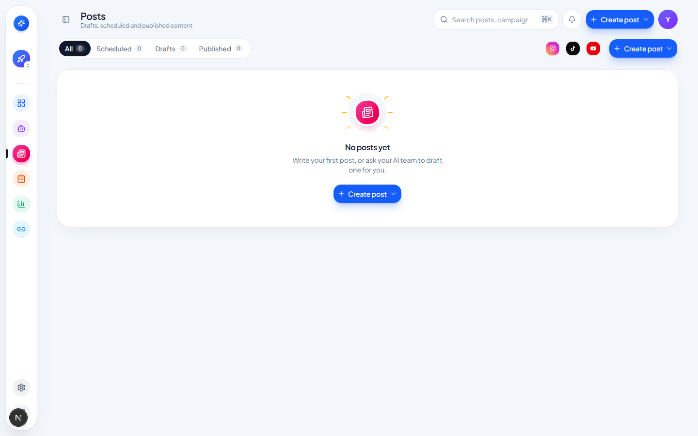
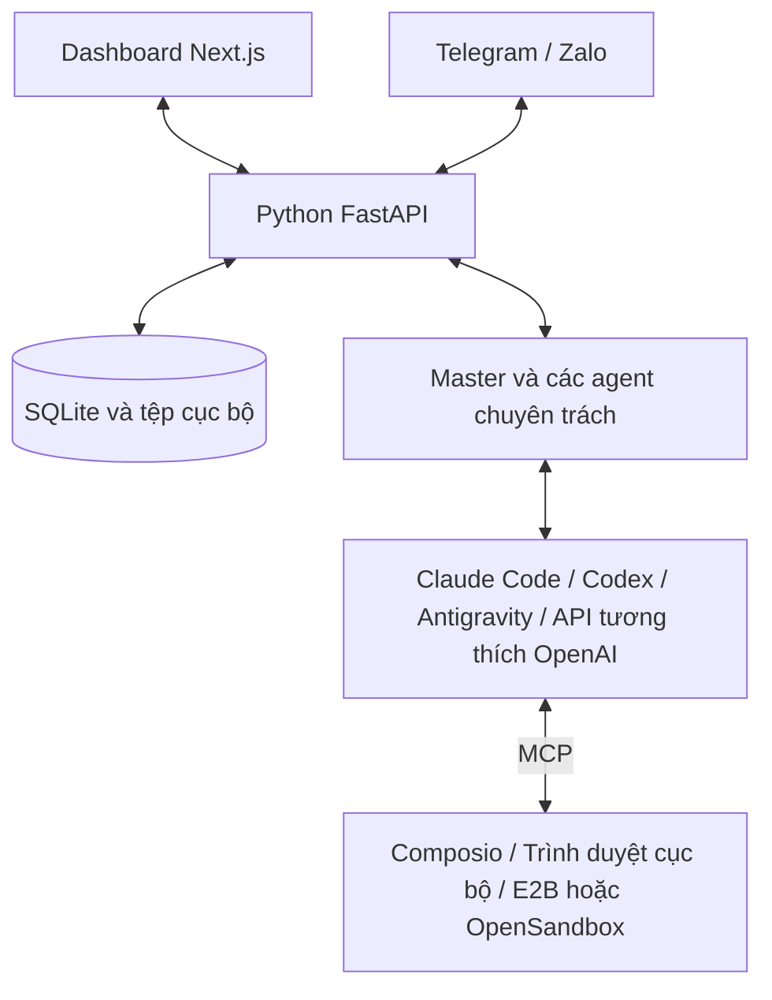

# **aiSocialTeam**

aiSocialTeam là ứng dụng đa tác tử để tạo nội dung mạng xã hội. Biến yêu cầu ban đầu thành quy trình phối hợp giữa năm AI agent: Master lập kế hoạch và phân công, Research tìm chủ đề và nguồn tham khảo, Creator viết chú thích và chuẩn bị hình ảnh, Scheduler sắp xếp lịch nội dung, còn Analytics hỗ trợ đánh giá hiệu quả. Trò chuyện với cả đội để phát triển ý tưởng, hoàn thiện bản nháp và chuẩn bị nội dung cho các chiến dịch.

Mỗi agent có thể dùng Claude Code, Codex hoặc Antigravity CLI, hoặc endpoint tương thích OpenAI, với hướng dẫn, mô hình, bộ nhớ, thư mục làm việc và ứng dụng kết nối riêng. Các agent có thể giao việc cho nhau, chạy theo lịch và nhận yêu cầu qua Telegram hoặc Zalo. Dashboard tập hợp cuộc trò chuyện của chiến dịch, bài đăng, lịch, phân tích và tài khoản mạng xã hội kết nối qua Composio. Dữ liệu chiến dịch và cuộc trò chuyện được lưu trên máy tính của bạn. Giao diện hỗ trợ tiếng Anh và tiếng Việt, chọn bằng nút ngôn ngữ phía trên Cài đặt ở cuối thanh bên.

Ứng dụng được xây dựng bằng Next.js và máy chủ Python (FastAPI). Giao diện web lấy cảm hứng từ video [Build Social Media AI Agent Team Using Claude Code & Next.js](https://www.youtube.com/watch?v=5GWTDRrwynY) của TubeGuruji.

[English](README.md) | **Tiếng Việt**

---

<p align="center"></p>

<table>
  <tr>
    <td width="33%"></td>
    <td width="33%"></td>
    <td width="33%"></td>
  </tr>
  <tr>
    <td width="33%"></td>
    <td width="33%"></td>
    <td width="33%"></td>
  </tr>
</table>

---

## ⚡ Bắt đầu nhanh

**macOS / Linux**

```bash
curl -fsSL https://raw.githubusercontent.com/jokerhung/aiSocialTeam/master/install.sh -o install.sh && bash install.sh
```

**Windows (PowerShell)**

```powershell
iwr -useb https://raw.githubusercontent.com/jokerhung/aiSocialTeam/master/install.ps1 -OutFile install.ps1; powershell -ExecutionPolicy Bypass -File install.ps1
```

Script cài Git, Node.js, Python và uv nếu còn thiếu, sao chép repository và cài các thư viện phụ thuộc. Thêm `--claude` / `-Claude`, `--codex` / `-Codex` hoặc `--antigravity` / `-Antigravity` để cài thêm CLI của engine. Xem đầy đủ tuỳ chọn và cách đăng nhập engine trong [hướng dẫn sử dụng](docs/user-guide.md).

---

## Bạn có thể làm gì

- **Làm việc theo chiến dịch.** Tạo chiến dịch với các agent Master, Research, Creator, Scheduler và Analytics riêng. Chuyển chiến dịch để làm việc với đội và tập bài đăng khác.
- **Giao việc và theo dõi cả đội.** Trò chuyện với Master, mở chat của từng agent và theo dõi việc được phân công trong Tasks cùng lịch sử agent. Văn phòng hiển thị cả đội cạnh khung làm việc. Bạn có thể ẩn panel ảnh và trình duyệt sẽ nhớ lựa chọn này.
- **Cấu hình từng agent.** Chọn engine, mô hình và mức suy nghĩ khả dụng trong tab Cài đặt của agent. Chỉnh sửa và lưu hướng dẫn riêng.
- **Chuẩn bị bài đăng.** Viết chú thích, hashtag, chọn nền tảng và tài khoản đã kết nối, đính kèm media, lưu bản nháp và xem trước nội dung trong trình soạn bài.
- **Tạo và sửa ảnh.** Chọn Codex CLI hoặc Gemini CLI đã cài trong cài đặt tạo ảnh của Creator. Dùng công cụ ảnh từ trình soạn bài hoặc yêu cầu Creator chuẩn bị ảnh.
- **Lập lịch nội dung.** Lên lịch, chuyển thời gian và huỷ lịch bài đăng. Xem số liệu đã lưu của bài đăng trong Phân tích.
- **Kết nối tài khoản mạng xã hội.** Nhập khoá Composio tại Cài đặt → Tích hợp, kết nối tài khoản và quản lý trong Tài khoản.
- **Xem agent thao tác trên giao diện.** Chọn Dùng trình duyệt, Dùng máy tính hoặc Tắt cho từng agent. Xem trình duyệt hoặc desktop, tiếp quản để đăng nhập hay xác minh, rồi trả quyền điều khiển.
- **Dùng hai ngôn ngữ.** Chọn tiếng Anh hoặc tiếng Việt từ thanh bên.

### Đăng bài và phân tích trong phiên bản này

Quy trình Bài đăng và Lịch lưu bản nháp cùng lịch đăng trên máy chủ cục bộ. Khi đến giờ, máy chủ đánh dấu bài đã xuất bản trong dữ liệu cục bộ. Luồng này chưa gửi bài lên mạng xã hội, và trạng thái đã xuất bản chưa phải xác nhận từ nền tảng.

Agent có cài đặt đăng bài riêng qua Composio hoặc giao diện trình duyệt/máy tính đã chọn. Khả năng đăng của agent phụ thuộc tài khoản kết nối, công cụ khả dụng, yêu cầu của nền tảng và chỉ dẫn của bạn. Khi xác minh bài đã đăng, kiểm tra kết quả agent báo và bài trên nền tảng.

Phân tích hiển thị số liệu được lưu cho các bài đăng. Máy chủ nhận số liệu qua `PUT /api/social/posts/{id}/metrics`. Luồng dữ liệu phân tích hiện tại của dashboard chưa triển khai tự thu thập số liệu từ các nền tảng.

## Bắt đầu sử dụng

Sau khi chạy script cài đặt ở phần Bắt đầu nhanh, khởi động ứng dụng từ thư mục dự án.

**Windows**

```powershell
.\start.bat
```

**macOS / Linux**

```bash
pnpm dev
```

Mở `http://127.0.0.1:5499` khi dùng các cổng trong `.env.example`.

1. Cài và đăng nhập ít nhất một CLI được hỗ trợ trên máy chạy server Python. Script cài đặt hỗ trợ `-Claude`, `-Codex`, `-Antigravity` trên Windows và `--claude`, `--codex`, `--antigravity` trên macOS/Linux. Hoàn tất đăng nhập bằng chính CLI.
2. Tạo chiến dịch. Ứng dụng tạo năm agent cho chiến dịch.
3. Mở **AI Agent**, chọn agent rồi mở **Cài đặt** để chọn engine, mô hình, mức suy nghĩ và lưu hướng dẫn. Danh sách engine phụ thuộc kết quả phát hiện của server.
4. Mở **Cài đặt → Tích hợp** để cấu hình Composio và kết nối tài khoản mạng xã hội nếu chiến dịch cần.
5. Gửi Master yêu cầu có đối tượng độc giả, nền tảng, chủ đề, giọng văn và kết quả mong muốn. Ví dụ, yêu cầu ba bản nháp giới thiệu sản phẩm kèm chú thích và ý tưởng hình ảnh.
6. Kiểm tra kết quả agent và bản nháp đã lưu trong **Bài đăng**, rồi sắp xếp thời gian trong **Lịch**.

### Các trang dashboard

| Trang | Chức năng |
|---|---|
| Tổng quan | Tóm tắt chiến dịch, hoạt động gần đây, bài sắp đăng và văn phòng của đội. |
| AI Agent | Chat với agent, nhiệm vụ của Master, lịch sử thành viên, cài đặt mô hình và hướng dẫn, màn hình trình duyệt/máy tính cùng tab Màn hình của Master. |
| Bài đăng | Tạo, chỉnh sửa nội dung, quản lý bản nháp và lịch đăng, đính kèm media, dùng tính năng tạo ảnh. |
| Lịch | Xem thời gian đăng, chuyển hoặc huỷ các mục đã lên lịch. |
| Phân tích | Xem số liệu đã lưu của bài đăng và so sánh hiệu quả. |
| Tài khoản | Xem và quản lý tài khoản mạng xã hội kết nối qua Composio. |
| Cài đặt → Tích hợp | Cấu hình khoá Composio và kết nối ứng dụng mạng xã hội. |
| Cài đặt → Dùng máy tính | Cấu hình, kiểm tra máy chủ E2B hoặc OpenSandbox và mở hướng dẫn thiết lập. |

### Tạo ảnh

Chọn công cụ trong **AI Agent → Creator → Cài đặt → Tạo ảnh**. Codex CLI và Gemini CLI dùng tài khoản đã cấu hình cục bộ. Gemini cần tiện ích hoặc tích hợp MCP có khả năng tạo ảnh.

Trình soạn bài hỗ trợ tạo ảnh và yêu cầu sửa ảnh. Giữ kết quả để đính kèm vào bài đăng. Media tạo ra được lưu tại `<BOTTEAM_DATA_DIR>/social-media`.

### Truy cập trình duyệt và máy tính

Trong **Cài đặt → Điều khiển giao diện** của từng agent, chọn chế độ rồi lưu.

| Chế độ | Yêu cầu và cách hoạt động |
|---|---|
| Dùng trình duyệt | Edge, Chrome hoặc Playwright Chromium cục bộ, cùng Node.js và npx cho Playwright MCP. Mỗi agent có hồ sơ trình duyệt riêng. |
| Dùng máy tính | Máy chủ E2B hoặc OpenSandbox đã cấu hình và kiểm tra kết nối thành công, Python 3.11+ và engine hỗ trợ ảnh từ công cụ. |
| Tắt | Tắt các công cụ giao diện tích hợp của agent trong chiến dịch. |

Chế độ trình duyệt ưu tiên Edge, rồi Chrome, sau đó Playwright Chromium. Nếu cần, cài Chromium bằng `uv run --project server playwright install chromium`. Cài đặt trình duyệt gồm hiển thị cửa sổ, truy cập địa chỉ nội bộ, tải tệp và xoá dữ liệu hồ sơ.

Chế độ máy tính hỗ trợ E2B Cloud, E2B tự host có KVM và OpenSandbox có Docker. Cấu hình kết nối và khoá API đầy đủ nằm ở server Python. Dashboard hiển thị khoá đã che và chuyển tiếp luồng desktop qua ứng dụng web.

- E2B Cloud xử lý nội dung desktop trên hạ tầng E2B theo giới hạn và giá của gói đăng ký.
- E2B tự host chạy trên máy của bạn, có thể giữ bộ nhớ qua snapshot khi tạm dừng và tiếp tục.
- OpenSandbox dùng container Docker. Tạm dừng có thể giữ phiên đang chạy trong khi container còn tồn tại. Xoá hoặc tạo lại container làm mất tệp và phiên đăng nhập.

Dùng **Mở rộng → Tiếp quản** để thao tác trên giao diện đã chọn, rồi **Trả quyền điều khiển** để agent tiếp tục. Công cụ máy tính của agent tạm ngưng khi người dùng nắm quyền. Xoá máy tính từ cài đặt agent sẽ xoá trạng thái đã lưu. Kết thúc hoặc xoá chiến dịch sẽ xoá các máy tính của chiến dịch.

Hướng dẫn thiết lập gồm [E2B tiếng Anh](docs/e2b-setup.en.md), [E2B tiếng Việt](docs/e2b-setup.vi.md), [OpenSandbox tiếng Anh](docs/opensandbox-setup.en.md) và [OpenSandbox tiếng Việt](docs/opensandbox-setup.vi.md). Mã dựng image desktop cho OpenSandbox nằm trong [docs/opensandbox-desktop](docs/opensandbox-desktop).

## Kiến trúc



Next.js cung cấp dashboard; FastAPI quản lý dữ liệu và thực thi agent. Master giao việc cho Research, Creator, Scheduler và Analytics, mỗi agent dùng engine AI đã cấu hình. Công cụ MCP kết nối agent với ứng dụng mạng xã hội, trình duyệt cục bộ hoặc máy tính từ xa. Dữ liệu được lưu cục bộ tại `BOTTEAM_DATA_DIR` (mặc định: `~/.botsocial`).

## Cài đặt và chạy từ mã nguồn

### Yêu cầu

- Git, Node.js 20+ và pnpm. Phiên bản pnpm của dự án được khai báo trong `package.json`.
- Python 3.10+ và [uv](https://docs.astral.sh/uv/). Dùng Python 3.11+ cho chế độ máy tính.
- Một engine AI đã cấu hình. Server hỗ trợ Claude Code, Codex, Antigravity và endpoint tương thích OpenAI. Từng tính năng phụ thuộc khả năng của engine.
- Edge hoặc Chrome cho chế độ trình duyệt, hoặc cài Playwright Chromium.
- Công cụ và dịch vụ tuỳ chọn cho tính năng bạn bật, như CLI tạo ảnh, Composio hoặc máy chủ máy tính.

Script cài đặt kiểm tra yêu cầu, cài thư viện dự án, tạo `.env` nếu thiếu, dựng ứng dụng web và chuẩn bị Playwright MCP. Các cờ cài engine là tuỳ chọn. Đăng nhập engine riêng sau khi cài. Máy chủ E2B và OpenSandbox được cấu hình riêng theo hướng dẫn thiết lập.

Với bản mã nguồn đã có, chạy các lệnh sau từ thư mục gốc dự án.

```bash
pnpm install --frozen-lockfile
uv sync --project server
```

Sao chép `.env.example` thành `.env` nếu chưa có tệp, rồi khởi động môi trường phát triển.

```bash
pnpm dev
```

### Dịch vụ và bản dựng production

| Lệnh | Chức năng |
|---|---|
| `pnpm dev` | Khởi động API Python và server phát triển Next.js cùng lúc. |
| `pnpm dev:server` | Khởi động API Python có tự tải lại. |
| `pnpm dev:web` | Chỉ khởi động server phát triển Next.js. |
| `pnpm build:static` | Dựng Next.js cho production vào `web/.next`. Tên script được giữ lại, bản dựng cần server Node.js khi chạy. |
| `pnpm start:one` | Khởi động API Python không dùng chế độ tự tải lại khi phát triển. |
| `pnpm start:web` | Phục vụ bản dựng web production. Chạy cùng API. |
| `pnpm dev:zalo` | Khởi động dịch vụ tài khoản Zalo cá nhân tuỳ chọn. |

Trên Windows, `start.bat` khởi động môi trường phát triển và giải phóng các cổng đã cấu hình trước. Script nhận thêm `server`, `web`, `one` và `zalo` để chạy từng dịch vụ.

### Cấu hình và truy cập mạng

Script khởi động đọc `.env` ở thư mục gốc. Giá trị trong `.env.example` như sau.

| Cài đặt | Giá trị | Chức năng |
|---|---|---|
| `WEB_PORT` | `5499` | Cổng dashboard. |
| `SERVER_PORT` | `9999` | Cổng API Python. |
| `WEBHOOK_PORT` | `9900` | Cổng nhận webhook. |
| `ZALO_PORT` | `8902` | Cổng dịch vụ Zalo tuỳ chọn. |
| `WEB_HOST` | `0.0.0.0` | Mở dashboard qua các giao diện mạng của máy. |
| `SERVER_HOST` | `127.0.0.1` | Giữ API Python trên loopback. |
| `BOTTEAM_DATA_DIR` | `~/.botsocial` | Dữ liệu lâu dài của ứng dụng. |

Với cấu hình trên, mở `http://<machine-ip>:5499` từ máy khác trong LAN hoặc Tailscale. Web chấp nhận localhost và địa chỉ IP LAN/Tailscale. Thêm tên máy khác vào `WEB_ALLOWED_HOSTS`. Dashboard dùng người dùng cục bộ và không có bước đăng nhập ứng dụng, nên truy cập được cổng web là có quyền vào workspace. Đặt `WEB_HOST=127.0.0.1` để chỉ dùng trên máy hiện tại.

Script khởi động có cổng dự phòng khi thiếu `.env`. Dùng `.env.example` để có các cổng ghi trong tài liệu. Các biến môi trường tuỳ chọn cho trình duyệt và máy chủ máy tính cũng nằm trong tệp đó.

## Kiểm tra khi phát triển

Chạy từ thư mục gốc dự án.

```bash
pnpm typecheck
pnpm test:web
pnpm test:server
pnpm test:zalo
```

`pnpm test` chạy kiểm thử server, ngôn ngữ web và Zalo cùng lúc. Thay đổi giao diện web phải hỗ trợ tiếng Anh và tiếng Việt. Xem quy tắc đóng góp trong [AGENTS.md](AGENTS.md).

## Giấy phép

aiSocialTeam hiện chưa có tệp giấy phép dự án. Thông báo về thành phần bên thứ ba nằm trong [NOTICE](NOTICE).

Repository [jokerhung/aiSocialTeam](https://github.com/jokerhung/aiSocialTeam).
