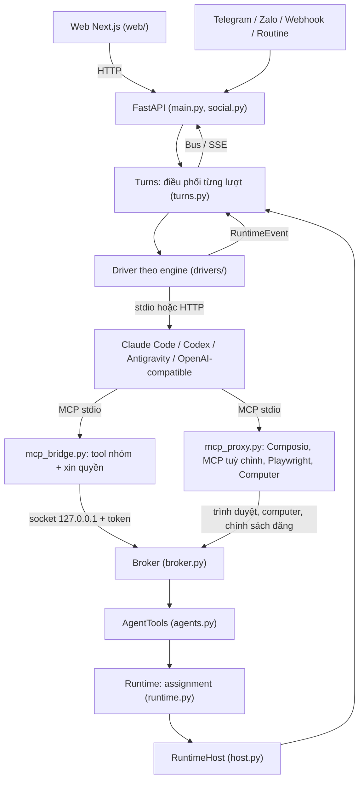
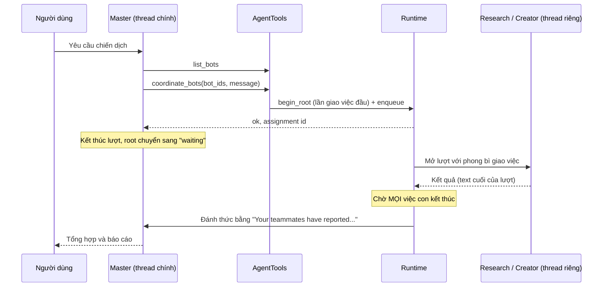
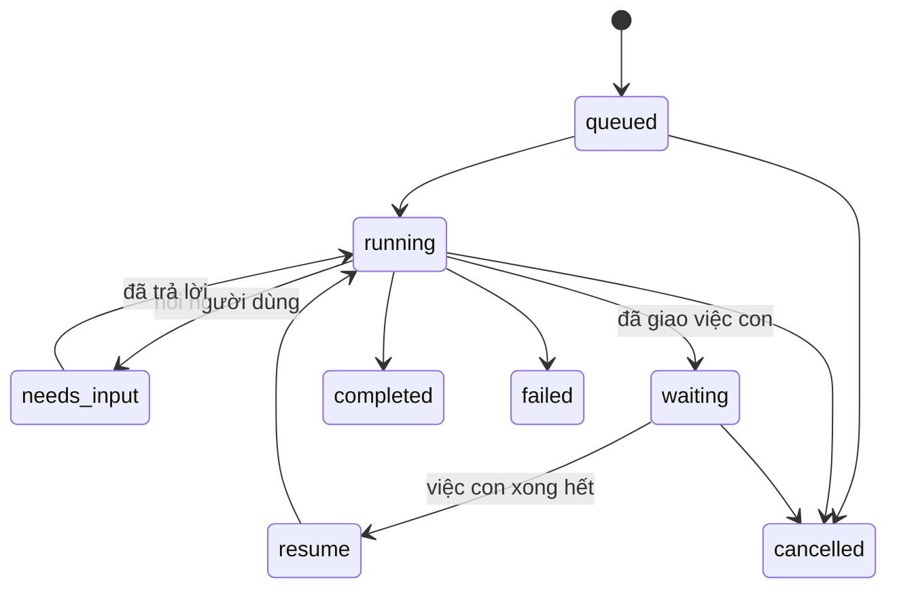

# Kiến trúc multi-agent của aiSocialTeam

Tài liệu dùng để chuẩn bị báo cáo. Nội dung được đối chiếu với mã nguồn ngày 25/11/2026 (commit `4171333`), dựa trên việc đọc code, không chạy thử luồng agent thật.

## 1. Tóm tắt nhanh

| Câu hỏi | Trả lời |
|---|---|
| Có dùng framework agent (LangChain, LangGraph, CrewAI, AutoGen, LlamaIndex) không? | **Không.** Phần điều phối được tự viết bằng Python `asyncio` + SQLite. |
| Có dùng SDK của hãng LLM (`anthropic`, `openai`, Claude Agent SDK) không? | **Không.** Server chạy các CLI (Claude Code, Codex, Antigravity) dưới dạng tiến trình con, hoặc gọi HTTP tới endpoint tương thích OpenAI. |
| Ai chạy vòng lặp "suy nghĩ → gọi tool → đọc kết quả"? | **CLI của engine.** Server chỉ gửi lượt (turn), nhận luồng sự kiện, cấp tool qua MCP và kiểm duyệt quyền. |
| Agent phối hợp bằng cách nào? | Qua tool MCP `coordinate_bots` và một **job runtime** lưu "assignment" trong `runtime.db`. |
| Mô hình phối hợp | Điều phối phân cấp (orchestrator–workers): Master giao việc, các agent chạy ở luồng riêng, Master được đánh thức khi có đủ kết quả. |
| Có RAG không? | **Không.** Không có embedding, vector database hay bước retrieval theo độ tương đồng (mục 7). |
| Giao thức tool | MCP (Model Context Protocol), JSON-RPC tự cài đặt, không dùng thư viện `mcp`. |

## 2. Đội agent

Mỗi chiến dịch tạo 5 bot thông thường của hệ thống (hằng `TEAM` trong [social.py](../server/botteam/social.py), API `POST /api/social/campaigns`).

| Role id | Tên | Nhiệm vụ | Hướng dẫn bổ sung trong system prompt |
|---|---|---|---|
| `master` | Master Agent | Lập kế hoạch, chia việc, báo cáo lại | Nhờ Creator lưu nháp, Scheduler lên lịch, rồi kiểm tra bằng `GET /api/social/posts` |
| `research` | Research Agent | Tìm xu hướng, chủ đề, hashtag, kèm nguồn | Xác minh bằng nguồn chính thức, ghi URL gốc (chế độ trình duyệt) |
| `creator` | Creator Agent | Viết caption, hook, hashtag, tạo ảnh | Gọi `POST /api/social/images` và `POST /api/social/posts` (ví dụ bằng `curl`) |
| `scheduler` | Scheduler Agent | Chọn giờ đăng, lên lịch | `PUT /api/social/posts/{id}` với `status: "scheduled"` |
| `analytics` | Analytics Agent | Báo cáo hiệu quả bài đăng | Dùng trình duyệt để đối chiếu số liệu khi cần |

Cả 5 agent **dùng chung một bộ máy**. Chúng khác nhau ở:

- **`soul`** (hướng dẫn vai trò): `soul_for()` ghép vai trò gốc + cách dùng trang Posts + quy tắc giao diện (browser / computer / off) + cách đăng bài (Composio / web).
- **Cấu hình riêng**: engine, model, mức suy nghĩ, mức phê duyệt, MCP server, skills, bộ nhớ, thư mục làm việc, chế độ giao diện.

System prompt của một lượt ([turns.py](../server/botteam/turns.py), `persona()` và `_system()`):

```text
persona (tên + chức danh + mô tả + soul)
  + ghi chú trong thư viện của bot (tối đa 6.000 ký tự)
  + phần bổ sung khi ở trong phòng chat (nếu có)
  + nội dung skills (với engine không phải Claude)
```

Khối bộ nhớ (`recall_block`) được chèn **trước tin nhắn của lượt**, không nằm trong system prompt.

## 3. Các tầng kiến trúc



| Thành phần | File | Trách nhiệm |
|---|---|---|
| Turn orchestrator | [turns.py](../server/botteam/turns.py) | Dựng đầu vào của lượt, gọi driver, biến sự kiện thành tin nhắn, retry (sau 1s và 3s), xếp hàng tin nhắn |
| Job runtime | [runtime.py](../server/botteam/runtime.py) | Bản ghi giao việc, vòng đời, ngân sách, đánh thức, khôi phục sau khi khởi động lại |
| Runtime host | [host.py](../server/botteam/host.py) | Nối runtime với engine và thread |
| Tool nhóm | [agents.py](../server/botteam/agents.py) | Thực thi tool mà agent gọi để làm việc với đồng đội |
| MCP bridge | [mcp_bridge.py](../server/botteam/mcp_bridge.py) | MCP server `bt` mà CLI khởi chạy |
| Broker | [broker.py](../server/botteam/broker.py) | Nhận lời gọi từ bridge và proxy; phê duyệt quyền, câu hỏi cho người dùng |
| Driver | [drivers/](../server/botteam/drivers/) | Chuyển giao thức từng engine thành `RuntimeEvent` chung |

Điểm thiết kế chính: mọi engine implement cùng giao diện `ProviderAdapter` (`send_turn`, `interrupt_turn`, `steer`, `on_event`, `stop_all`) trong [drivers/base.py](../server/botteam/drivers/base.py). Phần phía trên không phụ thuộc engine, và **mỗi agent trong đội có thể dùng một engine khác nhau**.

## 4. Cách các agent phối hợp

### 4.1. Luồng chính



Từng bước:

1. Người dùng chat với Master. Web gọi `web/app/api/agents/chat/route.ts`, gửi tin tới bot rồi poll mỗi 350 ms để stream câu trả lời.
2. Model của Master tự quyết định chia việc và gọi `coordinate_bots`. **Không có đồ thị hay pipeline cố định** kiểu Research → Creator → Scheduler. Thứ tự do LLM quyết định dựa trên soul và mô tả tool.
3. Lần giao việc đầu tiên tạo node gốc (`begin_root`), mỗi việc con là một dòng trong bảng `assignments`.
4. Mặc định mỗi việc chạy ở **thread mới** của agent nhận (`thread: "new"`). Agent nhận chỉ thấy brief và ngữ cảnh riêng của mình (soul, memory, notes), không thấy hội thoại của Master. Vì vậy brief phải đủ thông tin.
5. Vòng lặp của runtime (`tick`, mỗi 0,5 giây hoặc khi được `poke`) khởi động các việc đang `queued`. Việc ở các thread khác nhau chạy **song song**.
6. Master được dặn kết thúc lượt ngay sau khi giao việc. Nó không chờ chủ động, nên không giữ lượt LLM đang chạy.
7. Khi tất cả việc con có chờ trả lời đã kết thúc, runtime chuyển Master sang `resume` và mở lượt mới chứa toàn bộ kết quả (mỗi kết quả tối đa 12.000 ký tự).
8. Muốn chạy tuần tự (Research xong mới tới Creator), Master giao Research, được đánh thức, rồi giao tiếp cho Creator kèm kết quả.

### 4.2. "Phong bì" tin nhắn giữa các agent

Tin giao việc do server viết từ dữ liệu đã lưu, có dạng:

```text
[From @Master Agent · <chiến dịch> (bot) · assignment as_1a2b3c4d for ... · on their behalf at your level]
This is your task; do it with your own tools. Your level is full.
Done when: ...

<brief>
```

Hàm `escape_notes()` vô hiệu hoá mọi chuỗi giả mạo `[From ...` trong nội dung. Mức uỷ quyền có hai loại: `on their behalf at your level` (nguồn là người dùng hoặc routine) và `information only` (báo cáo, câu hỏi tham vấn, nguồn bên ngoài).

Báo cáo gửi về Master ghi thêm **bằng chứng quan sát được**, ví dụ `(observed: it acted with tools)` hoặc `it did not use tools`, kèm lời nhắc đối chiếu tuyên bố của đồng đội với quan sát đó. Đây là cách giảm rủi ro agent báo đã làm trong khi chưa làm. Cờ này chỉ cho biết agent có dùng tool tác động ra ngoài, không xác nhận kết quả đúng.

### 4.3. Tuỳ chọn của `coordinate_bots`

| Tham số | Ý nghĩa |
|---|---|
| `bot_ids`, `message` | Người nhận (id hoặc tên) và nội dung việc. Giao nhiều bot một lần được |
| `reply` | `resume` (mặc định: chờ kết quả) hoặc `none` (thông báo một chiều) |
| `consult` | Chỉ hỏi. Giới hạn "không hành động" nằm trong lời dặn của prompt, code không tự khoá tool |
| `thread` | `new` (mặc định), `standing` (thread chính) hoặc id thread |
| `done_when` | Tiêu chí hoàn thành |
| `rework` | Cho phép giao lại cùng một brief |
| `answers` | Trả lời câu hỏi đang chờ của đồng đội (chỉ bot giao việc hoặc Chief of Staff) |

### 4.4. Vòng đời assignment



### 4.5. Cơ chế an toàn của runtime

| Cơ chế | Chi tiết |
|---|---|
| Giới hạn độ sâu | `MAX_DEPTH = 3` cấp giao việc |
| Chống vòng lặp | Không giao ngược cho bot đã ở trong chuỗi (trừ `start_thread` mở thread mới cho chính mình) |
| Chống giao trùng | Băm SHA-1 brief đã chuẩn hoá, trừ khi `rework` |
| Ngân sách mỗi cây công việc | 12 lần giao, 24 lượt chạy, 12 lần đánh thức. Bộ đếm **được đặt lại mỗi khi có một việc kết thúc**, nên đây là giới hạn khi không có tiến triển, không phải trần tổng |
| Lỗi không làm sập lượt | Từ chối được trả về dạng `{ok: false, reason, detail}` |
| Dừng lan truyền | Stop huỷ cả cây việc con |
| Khôi phục sau restart | Lượt bị cắt chạy lại tối đa 1 lần, và **không chạy lại nếu đã tác động ra ngoài** (đọc từ log sự kiện của thread). Lượt do người dùng hoặc routine mở trực tiếp được đánh dấu bị gián đoạn |
| Truy vết | Mỗi lần đổi trạng thái ghi một dòng vào `assignment_events` (chỉ thêm); `check_invariants()` kiểm tra tính nhất quán |

Dữ liệu `runtime.db` gồm 4 bảng: `assignments`, `assignment_events`, `inbox`, `budgets`. API đọc: `/api/assignments`. Web ([team-work.ts](../web/lib/team-work.ts)) hiển thị chúng thành "plan" và "task". Do đó "kế hoạch" trên UI được **suy ra từ các lần giao việc**, không phải một planner riêng; trường `dependsOn` luôn rỗng.

### 4.6. Kênh phối hợp khác

- **Dữ liệu dùng chung**: các agent cùng đọc/ghi trang Posts qua HTTP API. Creator lưu nháp, Scheduler đọc rồi lên lịch, Master kiểm tra lại.
- **Phòng chat (rooms)** ([groups.py](../server/botteam/groups.py)): nhiều bot chung một transcript, trả lời lần lượt. Người trả lời được chọn bằng `@mention`, trưởng phòng, hoặc chế độ `auto` (một model nhỏ trên endpoint tương thích OpenAI). Bot `@mention` nhau tối đa 2 bước nối tiếp. Đội của chiến dịch không tự tạo phòng.
- **Team memory**: bộ nhớ dùng chung theo section (mục 7). Việc tạo chiến dịch không gán section cho bot.

### 4.7. Nguồn kích hoạt agent

| Nguồn | `origin` | File |
|---|---|---|
| Người dùng chat | `person` | `turns.py` |
| Lịch định kỳ (một lần, theo tuần, mỗi 5–1440 phút) | `routine` | [routines.py](../server/botteam/routines.py) |
| Webhook | `outside` | [webhooks.py](../server/botteam/webhooks.py) |
| Telegram / Zalo | `outside` | [channels/](../server/botteam/channels/) |
| Ứng dụng ngoài (Claude Desktop, Cursor) qua MCP server `mcp_app.py` | qua REST API | [mcp_app.py](../server/botteam/mcp_app.py) |

Ở chế độ trả lời khách qua Telegram/Zalo, agent chỉ được dùng hai tool nhóm là `sheet_rows` và `recall`. Nội dung của khách được đánh dấu là dữ liệu, không phải chỉ thị.

## 5. Engine và driver

| Engine | Giao thức | Phiên | Tool nhóm | Phê duyệt |
|---|---|---|---|---|
| **Claude Code** | `claude -p` với `stream-json` qua stdio | Một tiến trình sống lâu cho mỗi thread, `--resume` | Luôn được gắn (`--mcp-config`) | `--permission-prompt-tool mcp__bt__approve` |
| **Codex** | `codex app-server` (JSON-RPC) | `thread/start`, `thread/resume` | Chỉ khi `mount_agents` bật | Yêu cầu phê duyệt chuyển về broker; có sandbox |
| **Antigravity** | `agy acp` (Agent Client Protocol) | `session/new`, `session/resume` | Chỉ khi `mount_agents` bật | `session/request_permission` chuyển về broker |
| **OpenAI-compatible** | HTTP `/chat/completions` streaming | Không giữ phiên; gửi lại transcript (lấy tối đa 60 tin gần nhất) | **Không** | Không áp dụng |
| **Echo** | Giả lập | — | Để demo và test | — |

Lưu ý khi báo cáo:

- Với Codex và Antigravity, `mount_agents` bật khi agent chiến dịch ở chế độ **trình duyệt**, ở chế độ **máy tính** với engine được hỗ trợ, hoặc khi trả lời kênh chat. Nếu giao diện đặt **Off** thì lượt thường không có tool nhóm, nên Master dùng hai engine này không giao việc được.
- Driver OpenAI-compatible **không có vòng lặp tool calling**. Agent chạy trên engine này chỉ sinh văn bản: không giao việc, không gọi MCP, không tự lưu bài.
- File [drivers/codex.py](../server/botteam/drivers/codex.py) có driver `codex exec` cũ; registry hiện dùng `CodexAppDriver` và chỉ mượn hàm tiện ích từ file này.

Mọi driver phát cùng loại sự kiện: `session.started`, `turn.started`, `content.delta`, `item.started`, `item.completed`, `thread.token-usage.updated`, `context.compacted`, `runtime.error`, `turn.completed`. `Turns` ghi log NDJSON cho từng thread (bỏ các sự kiện chỉ dùng để stream) và lưu số token, chi phí. Việc nén ngữ cảnh do engine thực hiện.

## 6. Các tool của agent

### 6.1. Tool có sẵn của CLI

Đọc/ghi/sửa file, chạy shell, tìm kiếm, web search... tuỳ engine. Danh sách này **do CLI cung cấp, repo không định nghĩa**. Ví dụ Creator dùng shell (`curl`) để lưu bài và tạo ảnh qua HTTP API.

### 6.2. MCP server `bt`: hỏi người dùng và xin quyền

| Tool | Chức năng |
|---|---|
| `approve` | Xin quyền dùng tool (Claude gọi qua `--permission-prompt-tool`) |
| `ask_user` | Hỏi người dùng, có thể kèm lựa chọn, rồi chờ trả lời |

### 6.3. MCP server `bt`: tool nhóm

| Nhóm | Tool | Chức năng |
|---|---|---|
| Phối hợp | `list_bots` | Danh sách bot, vai trò, trạng thái bận |
| | `coordinate_bots` | Giao việc, tham vấn, thông báo, trả lời câu hỏi |
| | `assignment_status` | Xem trạng thái việc đã giao |
| | `start_thread`, `list_threads` | Mở/liệt kê luồng công việc |
| | `post_to_room`, `list_rooms` | Làm việc với phòng chat |
| Bộ nhớ | `remember`, `recall`, `forget` | Ghi, đọc, xoá ghi chú |
| | `team_remember` | Đề xuất ghi vào bộ nhớ chung, **luôn cần người dùng duyệt** |
| Lịch tự động | `trigger_info`, `trigger`, `delete_trigger` | Tạo, sửa, tạm dừng, chạy routine hoặc webhook |
| Giao diện | `browser_request_help` | Nhờ người dùng xử lý đăng nhập, CAPTCHA |
| Dữ liệu | `sheet_rows` | Tra dòng trong Google Sheets; việc so khớp do code làm, không để LLM đếm cột |
| Quản trị | `admin_list_bots`, `admin_create_bot`, `admin_update_bot` | Chỉ bot Administrator dùng được, và bot này chỉ dùng được tool admin |

Danh sách tool được liệt kê giống nhau cho mọi lượt (trừ `browser_request_help` bị ẩn ở chế độ computer/off). Quyền được kiểm tra **khi gọi**, trong `AgentTools.call()`.

### 6.4. Trình duyệt: Playwright MCP

- Dùng package `@playwright/mcp@0.0.86` qua `npx`, nối vào trình duyệt bằng CDP ([browser_mcp.py](../server/botteam/browser_mcp.py), [browser_host.py](../server/botteam/browser_host.py)).
- Mỗi agent có hồ sơ trình duyệt riêng.
- Bị tắt: `browser_close`, `browser_run_code`, `browser_run_code_unsafe`, `browser_install`.
- Các tool không nằm trong nhóm đọc/điều hướng đi qua broker để phê duyệt (tự cho phép ở mức `full`).
- Khi người dùng "Tiếp quản", agent không thao tác được.
- Nếu đăng bài qua Composio, việc mở trang soạn bài của các mạng xã hội trong danh sách bị chặn.
- Nội dung trang web được gắn nhãn "dữ liệu không tin cậy" để giảm rủi ro prompt injection.

### 6.5. Computer use (E2B hoặc OpenSandbox)

13 tool trong [computer_mcp.py](../server/botteam/computer_mcp.py): `computer_screenshot`, `computer_click`, `computer_move`, `computer_drag`, `computer_scroll`, `computer_type`, `computer_key`, `computer_launch`, `computer_wait`, `computer_run_command` (phải bật riêng), `computer_read_file`, `computer_write_file` (tối đa 10 MB), `computer_request_help`.

### 6.6. Composio và MCP server tuỳ chỉnh

- Composio được gọi bằng REST (`httpx`), không dùng SDK. Một **Tool Router Session** cung cấp MCP endpoint để agent dùng các ứng dụng đã kết nối ([composio.py](../server/botteam/composio.py)).
- Agent của chiến dịch được tự gắn Composio nếu đã cấu hình. Nếu bot chưa được cấp riêng, allowlist giới hạn vào các toolkit mạng xã hội: Twitter, Instagram, Facebook, YouTube, LinkedIn, TikTok, Threads, Pinterest, Reddit.
- Người dùng có thể thêm MCP server riêng (stdio, HTTP, SSE).
- Các MCP server này đi qua [mcp_proxy.py](../server/botteam/mcp_proxy.py), proxy này: giữ secret ngoài command line; lọc tool theo chế độ chỉ đọc hoặc allowlist; áp chính sách đăng bài; cắt kết quả quá dài (mặc định 20.000 ký tự, Composio 200.000) và lưu bản đầy đủ ra file; cache câu trả lời cho bot bị giới hạn bằng allowlist.

### 6.7. Tạo ảnh

Không phải MCP tool. Agent gọi `POST /api/social/images`; server chạy Codex CLI hoặc Gemini CLI để tạo file ảnh, mỗi lần một ảnh, timeout 300 giây ([images.py](../server/botteam/images.py)).

### 6.8. Skills

Mỗi skill là một file `SKILL.md` ([skills.py](../server/botteam/skills.py)). Claude nhận qua `--add-dir`; engine khác được chèn nội dung vào system prompt (tối đa khoảng 12.000 ký tự).

### 6.9. Phê duyệt (human-in-the-loop)

| Mức | Hành vi tại broker |
|---|---|
| `ask` | Hỏi người dùng, trừ các trường hợp được tự cho phép (tool `bt`, rule đã lưu, đọc file đính kèm, prefix được phép) |
| `edits` | Thêm: tự cho phép sửa file và lệnh chỉ đọc |
| `auto` | Ở broker giống `edits`; khác biệt còn lại tuỳ engine |
| `full` | Tự cho phép, **trừ `TeamMemory`** |

- Yêu cầu không ai trả lời sau 15 phút, hoặc broker không liên lạc được, thì bị **từ chối** (fail closed).
- **Mức mặc định của bot là `full`** (`DEFAULT_APPROVAL_MODE`), gồm cả bot của chiến dịch. Bot do import team hoặc do Administrator tạo bắt đầu ở `ask`. Nên nêu rõ điểm này khi nói về an toàn.
- "Chief of Staff" có thể truyền mức quyền của mình xuống việc được giao. Master của chiến dịch **không được đặt là Chief**, nên mỗi agent chạy theo mức của chính nó.

## 7. RAG và bộ nhớ

### 7.1. Không có RAG

Đã tìm trong mã nguồn: không có embedding, vector store (Chroma, FAISS, Qdrant, pgvector, Pinecone), chunking hay retriever.

Hệ thống có bảng **SQLite FTS5** (`msg_fts` trong [store.py](../server/botteam/store.py)) để tìm kiếm toàn văn tin nhắn qua `/api/search`. Đây là tính năng tìm kiếm cho người dùng (tool `search` của `mcp_app.py` cũng dùng cho ứng dụng ngoài). **Không có tool nhóm nào cho agent truy vấn nó**, và kết quả không được tự động đưa vào prompt.

### 7.2. Agent lấy ngữ cảnh bằng cách nào?

| Nguồn ngữ cảnh | Cách đưa vào |
|---|---|
| Soul + persona | System prompt |
| Notes trong thư viện của bot | Chèn thẳng vào system prompt, cắt ở 6.000 ký tự |
| `MEMORY.md` | Chèn trước tin nhắn của lượt, tối đa 200 dòng hoặc 24 KB |
| Team memory theo section | Chèn cùng khối recall, cùng giới hạn |
| `memory/<chủ đề>.md` | Agent tự gọi `recall(topic)`, đọc theo tên file, tối đa 20.000 ký tự |
| Lịch sử hội thoại | Phiên của CLI (`resume`), hoặc gửi lại transcript với OpenAI-compatible |
| Thông tin mới | Agent chủ động dùng web search, trình duyệt, Composio, đọc file, gọi API |

Có thể gọi cách lấy thông tin chủ động này là *agentic retrieval qua tool*, nhưng **không nên gọi là RAG** theo nghĩa thông thường (index, embedding, truy hồi, chèn ngữ cảnh).

Bộ nhớ lưu bằng file Markdown, ghi nguyên tử. Khi `MEMORY.md` vượt giới hạn qua `remember`, các mục có ngày cũ nhất chuyển sang `memory/archive.md`. `redact()` dùng regex thay các chuỗi giống API key, token, mật khẩu trước khi ghi qua `remember` và `team_remember`; đây là lọc theo mẫu nên không bắt được mọi bí mật.

## 8. Thư viện và công nghệ

### 8.1. Backend Python ([pyproject.toml](../server/pyproject.toml)), yêu cầu Python ≥ 3.10

| Thư viện | Phiên bản trong môi trường hiện tại | Vai trò |
|---|---|---|
| `fastapi` | 0.162.4 | REST API |
| `uvicorn[standard]` | 0.54.0 | ASGI server |
| `sse-starlette` | 3.7.0 | Server-Sent Events |
| `pydantic` | 2.14.3 | Schema và validate |
| `aiosqlite` | 0.22.1 | SQLite bất đồng bộ |
| `httpx` | 0.28.1 | Gọi HTTP (Composio, OpenAI-compatible...) |
| `pyyaml` | 6.0.3 | File team, intake |
| `tzdata` | — | Múi giờ cho routine |
| `playwright` | 1.65.0 | Quản lý trình duyệt |
| `e2b-desktop` | 2.7.2 (Python ≥ 3.11) | Desktop từ xa E2B |
| `opensandbox` | 1.2.1 | Desktop trong sandbox |
| `pytest`, `pytest-asyncio`, `asgi-lifespan` | dev | Kiểm thử |

Điều phối dùng thư viện chuẩn: `asyncio` (task, future, queue, subprocess, socket), `json`, `hashlib`, `uuid`.

### 8.2. Web ([web/package.json](../web/package.json))

Next.js 16, React 19, TypeScript, Tailwind CSS 4, shadcn / Base UI, Zod (validate), Recharts (biểu đồ), noVNC (xem desktop), lucide-react, date-fns.

### 8.3. Thành phần khác

- `zalo-service/`: Node.js ≥ 20, thư viện `zca-js` cho tài khoản Zalo cá nhân.
- Công cụ ngoài: CLI `claude`, `codex`, `agy`, `gemini` (tạo ảnh), `@playwright/mcp`.
- Lưu trữ: SQLite và file cục bộ trong `BOTTEAM_DATA_DIR` (mặc định `~/.botsocial`).

## 9. Hạn chế hiện tại

1. **Chưa đăng bài thật qua luồng Posts/Calendar.** Đến giờ hẹn, `_settle()` chỉ đánh dấu `published` trong dữ liệu cục bộ, và việc này chạy khi danh sách bài, một bài hoặc analytics được truy vấn. Agent có thể đăng qua Composio hoặc trình duyệt/computer, tách khỏi trạng thái này.
2. **Chưa tự thu thập số liệu.** Metrics được nhập qua `PUT /api/social/posts/{id}/metrics`.
3. **Chưa có ranh giới đội ở mức code.** `list_bots` trả về mọi bot, kể cả của chiến dịch khác. Việc Master chỉ giao cho đồng đội cùng chiến dịch dựa vào tên bot và prompt. Tương tự, quy tắc "worker chỉ nhận việc từ Master" không bị server ép buộc.
4. **Quy trình không tất định.** Master (LLM) quyết định chia việc, thứ tự và có giao việc hay không.
5. **Năng lực phụ thuộc engine** (mục 5).
6. **Mức phê duyệt mặc định là `full`** (mục 6.9).
7. **Không có RAG**, bộ nhớ dạng file có giới hạn kích thước.
8. **Không có đánh giá chất lượng tự động** (agent chấm điểm hay evaluator riêng). Master tự đối chiếu kết quả với cờ "đã dùng tool".

## 10. Gợi ý trình bày và câu hỏi thường gặp

**Câu mô tả một dòng:**

> aiSocialTeam là hệ multi-agent theo mô hình orchestrator–workers, tự xây lớp điều phối bất đồng bộ có lưu trạng thái trên SQLite, dùng MCP làm giao thức tool và dùng các coding agent CLI làm bộ máy suy luận, có thể thay engine theo từng agent.

**Dàn ý slide:** bài toán → đội 5 agent → kiến trúc tầng (mục 3) → sequence phối hợp (mục 4.1) → độ tin cậy (4.5) → tool và MCP (6) → an toàn và human-in-the-loop (6.9) → memory so với RAG (7) → công nghệ (8) → hạn chế (9).

| Câu hỏi | Gợi ý trả lời |
|---|---|
| Sao không dùng LangChain/LangGraph? | Vòng lặp agent đã có trong CLI; phần cần xây là giao việc, trạng thái bền, phê duyệt và hỗ trợ nhiều engine. Đây là suy luận từ kiến trúc, code không ghi lý do chọn. |
| Agent có nói chuyện trực tiếp với nhau không? | Không có kết nối trực tiếp giữa các tiến trình. Mọi thứ đi qua server: assignment, phòng chat, dữ liệu Posts. |
| Có chạy song song không? | Có, các việc ở thread khác nhau chạy đồng thời. Một thread chỉ chạy một lượt tại một thời điểm. |
| Server chết giữa chừng thì sao? | Trạng thái nằm trong `runtime.db`; `recover()` xử lý, không chạy lại lượt đã tác động ra ngoài. |
| Làm sao tránh agent giao việc vô hạn? | Độ sâu tối đa 3, cấm giao ngược, chống trùng, ngân sách khi không tiến triển. |
| Nguồn gốc thiết kế? | Comment trong code cho biết runtime là bản rút gọn của hợp đồng runtime từ dự án tham chiếu (`docs/runtime-contract.md` của dự án đó). |

## 11. Bản đồ mã nguồn

| Muốn tìm hiểu | Bắt đầu từ |
|---|---|
| Định nghĩa đội agent và prompt | `server/botteam/social.py` (`TEAM`, `soul_for`) |
| Giao việc, đánh thức | `server/botteam/agents.py` (`t_coordinate_bots`), `runtime.py` (`enqueue`, `tick`, `_maybe_resume`) |
| Một lượt chạy | `server/botteam/turns.py` (`_start_turn`, `_handle`) |
| Tích hợp engine | `server/botteam/drivers/`, `registry.py` |
| Định nghĩa schema tool nhóm | `server/botteam/mcp_bridge.py` (`TEAM_TOOLS`) |
| Quyền | `server/botteam/approval.py`, `broker.py` |
| Bộ nhớ | `server/botteam/memory.py` |
| Nối các thành phần | `server/botteam/main.py` (`create_app`) |
| Test liên quan | `server/tests/test_runtime.py`, `test_drivers.py`, `test_memory.py`, `test_mcp.py` |
