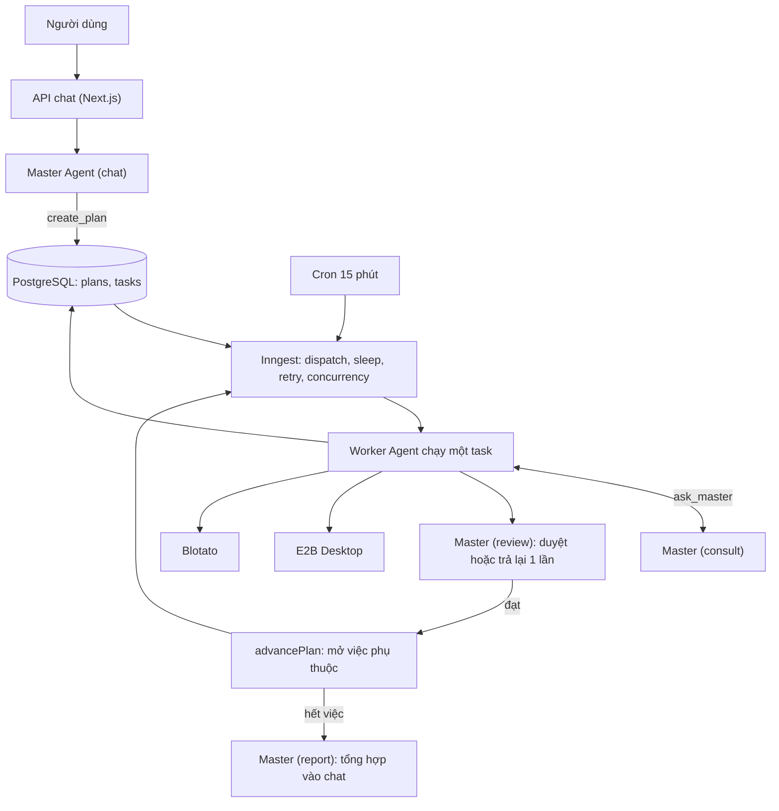

# Báo cáo tham khảo `social-media-ai-agent` và so sánh với aiSocialTeam

- **Dự án tham khảo:** `D:\hungnm\github\social-media-ai-agent-main` (gọi tắt là **SMAA**). Thư mục không phải git repo nên không ghi được commit.
- **Dự án hiện tại:** aiSocialTeam, commit `4171333`. Chi tiết kiến trúc ở [agent-architecture.vi.md](agent-architecture.vi.md).
- **Phương pháp:** đọc mã nguồn ngày 25/11/2026, tập trung vào phần agent, điều phối, tool, dữ liệu và đăng bài. Không đọc hết mọi file, không chạy thử ứng dụng, không chạy test.
- Đường dẫn bắt đầu bằng `SMAA:` là file trong dự án tham khảo.

## 1. Kết luận chính

1. Hai dự án giải **cùng bài toán** với **cùng đội 5 agent** (Master, Research, Creator, Scheduler, Analytics), nhưng **lõi agent khác hẳn nhau**.
2. **SMAA là một pipeline chuyên cho mạng xã hội:** dùng OpenAI Agents SDK và Inngest. Có kế hoạch rõ ràng, phụ thuộc giữa các việc, lịch lặp, Master duyệt kết quả, dữ liệu đầu ra có cấu trúc, đăng bài và đồng bộ số liệu qua Blotato.
3. **aiSocialTeam là một nền tảng agent tổng quát** có thêm lớp mạng xã hội: tự viết runtime, dùng CLI agent (Claude Code, Codex, Antigravity), nhiều lựa chọn engine, chạy trên máy cục bộ, phê duyệt theo từng thao tác, bộ nhớ, MCP và kênh Telegram/Zalo.
4. Về **nghiệp vụ mạng xã hội**, SMAA đi xa hơn: đã nối đăng bài thật và phân tích. Trong aiSocialTeam, luồng Bài đăng/Lịch chưa gửi bài lên mạng và số liệu chưa tự thu thập.
5. Về **tính linh hoạt và hạ tầng agent**, aiSocialTeam rộng hơn.
6. **Cả hai đều không dùng RAG dựa trên embedding/vector database** (theo kết quả tìm trong mã nguồn).

**Quan hệ giữa hai codebase:** phần web giống nhau rõ rệt. Trong thư mục `components`, `lib`, `app`, có 152 file `.ts/.tsx` cùng đường dẫn ở hai bên: **70 file giống hệt** (không tính khác biệt xuống dòng) và 82 file đã sửa. aiSocialTeam có tổng 194 file, SMAA có 203. Tài liệu [phase 10](phase-10-computer-use-e2b-embed.md) cũng ghi SMAA là bản tham chiếu. Phần backend thì được viết khác hoàn toàn: SMAA đặt trong Next.js, aiSocialTeam dùng server Python.

## 2. Tổng quan SMAA

### 2.1. Công nghệ

| Nhóm | Thư viện / dịch vụ | Phiên bản cài đặt | Vai trò |
|---|---|---|---|
| Framework agent | `@openai/agents` | 0.20.0 | `Agent`, `run`, tool schema bằng Zod, lưu/khôi phục `RunState`, MCP client |
| LLM | `openai` | `^7.32.0` (khai báo) | Gọi model, tải ảnh chụp màn hình lên Files API |
| Chạy nền và lịch | `inngest` | 3.54.2 | Cron, sleep đến giờ, retry, giới hạn đồng thời, idempotency |
| Cơ sở dữ liệu | PostgreSQL, `drizzle-orm`, `postgres` | drizzle 0.45.4 | Plan, task, message, kết quả, bài đăng, số liệu |
| Backend dịch vụ | InsForge (`@insforge/sdk`) | `^1.5.2` | Đăng nhập, Postgres, lưu file |
| Máy ảo | `@e2b/desktop` | 2.2.3 | Desktop Linux cho agent |
| Đăng bài, số liệu | Blotato (REST và MCP) | — | Tài khoản mạng xã hội, lịch đăng, analytics |
| Ảnh | Gemini REST, ImageKit, OpenAI Images | — | Tạo và biến đổi ảnh |
| Web | Next.js 16, React 19, Tailwind 4, shadcn, Zod, Recharts | — | Giao diện và API |

**Model:** trong các file `new Agent(...)` đã đọc, không agent nào khai báo `model`, nên dùng mặc định của SDK. Bản đang cài lấy biến `OPENAI_DEFAULT_MODEL`, nếu không có thì là `gpt-5.6-luna`.

### 2.2. Kiến trúc

### 2.3. Các agent LLM

Ngoài 4 worker, "Master" được tách thành nhiều agent nhỏ, mỗi agent một nhiệm vụ.

| Agent | File | Nhiệm vụ | Đầu ra |
|---|---|---|---|
| Master (chat) | `SMAA: lib/ai/master.ts` | Lập kế hoạch, quản lý plan, trả lời người dùng | Text và tool |
| Master (consult) | `SMAA: lib/orchestration/coordinator.ts` | Trả lời câu hỏi của worker hoặc quyết định hỏi người dùng | Có cấu trúc (`needs_user`, `answer`) |
| Master (review) | như trên | Duyệt kết quả | Có cấu trúc (`approved`, `feedback`) |
| Master (report) | như trên | Viết báo cáo khi plan hoàn thành | Text |
| Worker chạy task (4) | `SMAA: lib/orchestration/worker.ts` | Thực thi một task | `report_result` |
| Worker chat (4) | `SMAA: lib/ai/agents.ts` | Chỉ giải đáp, không nhận việc (Analytics được tra số liệu) | Text |
| Copywriter | `SMAA: lib/ai/tools/content.ts` | Agent phụ được gọi trong tool `generate_copy` | Có cấu trúc |

### 2.4. Cách phối hợp

1. Master gọi `create_plan` với tối đa **8 task**. Mỗi task có agent, hướng dẫn, `depends_on`, `run_at` và `repeat`.
2. Code kiểm tra key trùng, agent không tồn tại, phụ thuộc thiếu, phụ thuộc vòng (topological sort), rồi lưu plan trong một transaction. Chỉ được hẹn trước tối đa 90 ngày.
3. Task đến hạn và đủ phụ thuộc được chuyển sang `queued` và gửi thành event `task/execute`. Việc này diễn ra ngay sau câu trả lời của Master, và nhờ cron 15 phút cho việc hẹn sau.
4. Inngest ngủ đến đúng giờ. Giới hạn đồng thời là 4 task cho mỗi người dùng và 1 task cho mỗi cặp chiến dịch–agent.
5. Worker nhận đầu ra của các task phụ thuộc, gồm text, nghiên cứu, bản nháp và file.
6. Worker buộc phải gọi tool ở mỗi lượt (`toolChoice: "required"`) và kết thúc bằng `report_result`. Research phải lưu nghiên cứu, Creator phải lưu bản nháp trước khi báo cáo: lần đầu thiếu thì bị trả lại. Hàm kiểm tra này chỉ chạy một lần và bị bỏ qua khi hết giờ.
7. Master review. Nếu không đạt thì trả lại, **tối đa 1 lần sửa**. Nếu bản thân bước review bị lỗi, kết quả được **tự động chấp nhận**.
8. `advancePlan` huỷ các task có phụ thuộc thất bại, mở các task tiếp theo và gửi báo cáo tổng hợp vào chat khi plan xong.

**Độ tin cậy:**

| Cơ chế | Cách làm |
|---|---|
| Chống chạy trùng | `queueSeq`, `runOwner`, cập nhật có điều kiện, khoá unique `(task_id, queue_seq)`, idempotency của Inngest |
| Chạy dài | Mỗi step làm khoảng 2,5 phút rồi lưu `RunState` để step sau chạy tiếp |
| Giới hạn thời gian | Nhắc kết thúc ở phút 3, hạn ở phút 4,5; bản sửa có hạn 2 phút |
| Giới hạn lượt | Research và Creator 80, Scheduler và Analytics 30 |
| Retry | Task: thử lại 2 lần. Lỗi gọi model: tối đa 3 lần, có backoff |
| Việc lặp | Dừng sau 3 lần thất bại liên tiếp |
| Task bị bỏ rơi | Cron phát hiện task không cập nhật quá lâu và xếp lại hàng |
| Chờ người dùng | Lưu trạng thái, tạm dừng máy (trừ khi người dùng đang tiếp quản), hết hạn sau 24 giờ |

**Điều chỉnh agent khi đang chạy:**

- Chỉ gửi lại cho model **2 ảnh chụp màn hình mới nhất**.
- Nếu người dùng bổ sung thông tin, bản hướng dẫn mới được chèn vào lượt gọi model tiếp theo.
- "Ghi chú giám sát" được tự thêm khi agent lặp một thao tác 3 lần, lỗi liên tiếp 3 lần, sắp hết giờ hoặc hết lượt.

### 2.5. Tool

| Agent | Tool |
|---|---|
| Master | `create_plan`, `get_plan_status`, `find_saved_work`, `answer_agent_question`, `update_task`, `resume_waiting_task`, `cancel_plan`, `retry_plan`, cùng các tool MCP chỉ đọc của Blotato (khi đã kết nối) |
| Mọi worker | `ask_master` (tối đa 2 câu mỗi lần chạy), `send_update`, `report_result` |
| Agent có máy (Research, Creator) | `computer_action` (gồm cả chạy lệnh shell trong sandbox), `file_storage`, `request_user_action` |
| Research | `web_search`, `read_page`, `save_research` |
| Creator | `generate_copy`, `save_draft`, `generate_image`, `transform_image`, `web_search`, `read_page` |
| Scheduler | `list_publishing_accounts`, `list_posts`, `schedule_post`, `unschedule_post` |
| Analytics | `sync_analytics`, `get_analytics_summary`, `list_post_performance`, `get_post_analytics` |

Hai điểm đáng chú ý:

- `save_research` đối chiếu nguồn được khai là "đã kiểm tra trực tiếp" với danh sách trang trình duyệt đã mở. Nếu không khớp thì hạ thành "chưa kiểm tra". Việc so khớp **theo tên miền**, không theo đúng URL, nên không chứng minh được nội dung trích dẫn.
- `save_draft` kiểm tra giới hạn từng nền tảng và chỉ nhận URL media đã được tạo trong chiến dịch.

### 2.6. Dữ liệu, bộ nhớ và RAG

- Dữ liệu có cấu trúc trong Postgres: `agent_plans`, `agent_tasks`, `agent_task_runs`, `agent_communications`, `agent_artifacts`, `research_findings`, `content_drafts`, `agent_outputs`, `posts`, `post_analytics`, và các bảng sandbox, tích hợp.
- Chat gửi tối đa 40 tin gần nhất làm ngữ cảnh. Master còn nhận ảnh chụp trạng thái các plan và câu hỏi đang chờ.
- `find_saved_work` là **truy hồi theo từ khoá do agent gọi**: `agent_outputs` dùng full-text search của Postgres (cấu hình `english`) kèm `ILIKE` trên tiêu đề; nghiên cứu và bản nháp dùng `ILIKE`. Với nội dung tiếng Việt, cấu hình `english` không xử lý ngôn ngữ phù hợp.
- Không thấy embedding hay vector search.
- **Bộ nhớ chiến dịch và campaign brief chưa có trong code.** Chúng mới nằm trong tài liệu prompt `SMAA: docs/prompts/chapter-11-campaign-brief-and-memory.md`.

### 2.7. Máy ảo, đăng bài và phân tích

- **E2B:** mỗi agent có máy riêng trong mỗi chiến dịch (chỉ Research và Creator), dùng lease để một máy chỉ phục vụ một task. Máy rảnh 3 phút thì được tạm dừng bởi cron chạy mỗi phút. Khi người dùng tiếp quản, thao tác tiếp theo của agent bị giữ lại. Kết thúc chiến dịch thì xuất file rồi tắt máy.
- **Đăng bài:** Scheduler gọi `schedule_post`, bài được lưu ở trang Posts và lên lịch trong Blotato, rồi Inngest theo dõi trạng thái. Nền tảng đăng được là Instagram, TikTok và YouTube.
- **Phân tích:** đồng bộ số liệu từ Blotato mỗi 6 giờ (và khi mở trang nếu dữ liệu đã cũ). Chỉ số chưa được báo cáo giữ là `null`, không tính thành 0.

### 2.8. Điểm yếu của SMAA

| Vấn đề | Chi tiết |
|---|---|
| **Có thể báo "đã đăng" khi chưa xác nhận** | `finishPost()` trong `SMAA: lib/posts/publish.ts` đặt trạng thái `published` nếu còn nền tảng ở `scheduled` hoặc `in-progress` sau khi hết số lần kiểm tra, kể cả khi chưa nền tảng nào xác nhận. Trường `error` có ghi "still processing" |
| Review "mở khi lỗi" | Review lỗi thì kết quả được chấp nhận |
| Đăng bài không có bước duyệt riêng | Yêu cầu của người dùng được coi là đồng ý; việc không đăng ngoài yêu cầu dựa chủ yếu vào prompt |
| Huỷ plan không dừng ngay | Task đang chạy vẫn làm hết step hiện tại, nên tool trong step đó vẫn có thể gây tác động |
| Phụ thuộc nhiều dịch vụ | OpenAI, PostgreSQL, InsForge, Inngest; thêm E2B, Blotato, ImageKit, Gemini tuỳ tính năng |
| Khoá một hệ model | Vòng lặp agent viết trên OpenAI Agents SDK |
| Tài liệu lệch code | `SMAA: docs/agent-workflow.md` ghi một máy ảo chung cho cả chiến dịch, vai trò Publisher, và phần đăng bài mới là thiết kế. Code hiện có máy riêng cho từng agent, Publisher đã được thay bằng Analytics (migration), và đã có `publish.ts` |
| Thiếu test | Không tìm thấy file `*.test.*`, thư mục `tests` hay README |

> Khi báo cáo, nên lấy code làm chuẩn thay vì `agent-workflow.md`.

## 3. So sánh chi tiết

### 3.1. Nền tảng

| Tiêu chí | SMAA | aiSocialTeam |
|---|---|---|
| Backend | TypeScript, trong Next.js | Python FastAPI, tách khỏi web Next.js |
| Vòng lặp agent | OpenAI Agents SDK | CLI của engine; server không tự chạy vòng lặp tool |
| Model | OpenAI | Chọn theo từng agent: Claude Code, Codex, Antigravity, endpoint tương thích OpenAI (endpoint này chỉ sinh text) |
| Chạy nền | Inngest | Vòng lặp `asyncio` tự viết |
| Lưu trữ | PostgreSQL (InsForge) | SQLite và file cục bộ |
| Người dùng | Đăng nhập, dữ liệu theo từng người dùng | Một người dùng cục bộ; truy cập qua tên miền cần ghép nối |
| Kiểu triển khai | Web app dựa vào dịch vụ bên ngoài | Chạy trên máy của người dùng, có script cài đặt |
| Ngôn ngữ giao diện | Chưa thấy lớp i18n | Tiếng Anh và tiếng Việt |

### 3.2. Điều phối

| Tiêu chí | SMAA | aiSocialTeam |
|---|---|---|
| Đơn vị công việc | Plan gồm các task | Cây assignment |
| Lập kế hoạch | Một lần, có cấu trúc (`create_plan`) | Giao dần bằng `coordinate_bots` |
| Phụ thuộc | `depends_on`, code kiểm tra và tự mở việc | Không có; Master được đánh thức rồi giao tiếp |
| Ai giao việc | Chỉ Master | Bot nào có tool nhóm đều giao được; quy tắc "chỉ Master" nằm ở prompt |
| Phạm vi | Theo người dùng và chiến dịch, lọc trong code | `list_bots` thấy mọi bot |
| Hẹn giờ một việc | `run_at` cho từng task | `coordinate_bots` không có tham số giờ chạy; dùng routine |
| Việc lặp | Daily, weekly, monthly theo múi giờ, gắn với task | Routine: một lần, theo tuần, theo khoảng phút |
| Duyệt kết quả | Bước review riêng, tối đa 1 lần sửa | Không có bước bắt buộc; Master tự đối chiếu khi nhận báo cáo |
| Bằng chứng | Dòng hoạt động trên máy tính, danh sách URL đã mở | Cờ "đã/chưa dùng tool" |
| Hỏi đáp | `ask_master` → consult → người dùng nếu cần | `ask_user`; bot giao việc có thể trả lời thay bằng `answers` |
| Bổ sung giữa chừng | `update_task` tác động cả task đang chạy | Chưa thấy tool sửa assignment; tin nhắn người dùng có thể "steer" lượt đang chạy trên thread đó với engine hỗ trợ (Claude) |
| Giới hạn | 8 task mỗi plan, giới hạn lượt và thời gian | Độ sâu 3, ngân sách khi không tiến triển, chống giao ngược và giao trùng |
| Khôi phục | Chạy tiếp từ `RunState` đã checkpoint | Chạy lại tối đa 1 lần, không chạy lại nếu đã tác động ra ngoài |
| Thời lượng một việc | Vài phút, ép kết thúc | Không thấy hạn chung cho assignment; routine và kênh chat có timeout |

**Ý nghĩa:** SMAA **tất định hơn** ở phần thực thi sau khi đã lập plan, vì code quyết định thứ tự. Việc chia plan vẫn do LLM. aiSocialTeam **linh hoạt hơn** (nhiều tầng giao việc, đổi hướng sau mỗi báo cáo) nhưng khó dự đoán hơn.

**Dấu vết trên giao diện hiện tại:** [team-work.ts](../web/lib/team-work.ts) chuyển assignment thành "plan/task" với các khái niệm giống SMAA, nhưng backend chưa cung cấp nhiều trường, nên đang điền giá trị giữ chỗ: `dependsOn: []`, `repeat: null`, `review: null`, `revisions: 0`, `attempts: 1`, `artifacts: []`, `drafts: []`, `research: []`. Ngoài ra `completedAt` lấy **thời điểm đọc dữ liệu**, không phải lúc việc hoàn thành, và `updatedAt` lấy thời điểm tạo. Không nên dùng các trường này làm số liệu trong báo cáo.

### 3.3. Tool và dữ liệu đầu ra

| Tiêu chí | SMAA | aiSocialTeam |
|---|---|---|
| Cách định nghĩa | Tool TypeScript với schema Zod, cấp theo vai trò | Tool CLI và MCP; danh sách tool nhóm giống nhau, quyền kiểm tra khi gọi |
| Lưu nghiên cứu | `save_research` có cấu trúc và nguồn | Kết quả là text; có thể ghi memory |
| Lưu bản nháp | `save_draft`, kiểm tra giới hạn nền tảng | Creator tự gọi HTTP API (ví dụ `curl`) theo hướng dẫn trong soul |
| Viết nội dung | Agent copywriter riêng | Creator tự viết |
| Tạo ảnh | Gemini API, ImageKit, OpenAI | Codex CLI hoặc Gemini CLI qua HTTP API |
| Duyệt web | Điều khiển desktop; thêm `web_search`, `read_page` | Playwright MCP, tool có sẵn của CLI, hoặc computer use |
| MCP | Chỉ thấy dùng cho Blotato | Trọng tâm: tool nhóm, Composio, Playwright, Computer, server tuỳ chỉnh |
| Skills | Không thấy | Có (`SKILL.md`) |
| Tool quản trị bot | Không thấy | Có (Administrator) |

Tool có kiểu dữ liệu giúp SMAA kiểm tra đầu vào ngay khi agent lưu. Cách dùng `curl` của aiSocialTeam phụ thuộc engine có shell và mạng. API bài đăng có validate cơ bản (trạng thái, tên nền tảng, thời gian), nhưng trong đoạn code đã đọc **không kiểm tra độ dài caption hay yêu cầu media theo nền tảng**. Theo mapping trong driver Codex, các mức phê duyệt khác `full` đặt sandbox `workspaceWrite` với `networkAccess: false`, nên `curl` có thể không chạy được.

### 3.4. Bộ nhớ và truy hồi

| Tiêu chí | SMAA | aiSocialTeam |
|---|---|---|
| RAG bằng vector | Không | Không |
| Agent tìm lại công việc cũ | Có `find_saved_work` (chỉ Master) | Không có tool tìm transcript; FTS5 dành cho giao diện và ứng dụng ngoài |
| Bộ nhớ dài hạn | Dữ liệu kết quả trong DB; chưa có campaign memory | `MEMORY.md`, topic, team memory, notes |
| Ngữ cảnh giữa các việc | Tự đưa đầu ra của task phụ thuộc vào | Master viết vào brief; agent nhận không thấy hội thoại của Master |

### 3.5. Máy tính, đăng bài, phân tích

| Tiêu chí | SMAA | aiSocialTeam |
|---|---|---|
| Nhà cung cấp máy | E2B Cloud | E2B Cloud, E2B tự host, OpenSandbox |
| Trình duyệt cục bộ | Không | Có, mỗi agent một hồ sơ |
| Agent được dùng | Research, Creator | Cấu hình cho từng agent |
| Chạy shell trong máy | Có sẵn trong `computer_action` | Tắt mặc định, phải bật `runCommands` |
| Tiếp quản | Có | Có |
| Dịch vụ đăng bài | Blotato, gắn chặt với trang Posts | Agent đăng qua Composio hoặc giao diện; **Posts/Calendar không gửi bài** |
| Trạng thái đăng | Theo dõi từng nền tảng (còn lỗi ở mục 2.8) | `_settle()` đánh dấu `published` cục bộ khi đến giờ |
| Số liệu | Đồng bộ tự động | Nhập qua API `PUT .../metrics` |
| Kênh ngoài | Không thấy | Telegram, Zalo, webhook |

### 3.6. An toàn và kiểm thử

| Tiêu chí | SMAA | aiSocialTeam |
|---|---|---|
| Cách ly | Desktop E2B; các tool đã đọc không chạy lệnh trên máy chủ ứng dụng | CLI chạy trên máy của người dùng; mức sandbox tuỳ engine và mức quyền |
| Phê duyệt thao tác | Không có phê duyệt tổng quát. `needsApproval` chủ yếu để checkpoint, tiếp quản và chờ đăng nhập | Broker phê duyệt theo bốn mức; **mặc định `full`** |
| Phạm vi dữ liệu | `userId` và `campaignId`; migrations bật RLS | Một người dùng; chưa cách ly giữa các đội |
| Lưu secret | Khoá Blotato mã hoá AES-256-GCM | File cấu hình giới hạn quyền truy cập (`chmod 0600`; trên Windows tác dụng hạn chế); không thấy mã hoá trong `config.py` |
| Chống prompt injection | Chủ yếu bằng chỉ dẫn trong prompt, giới hạn tool theo vai trò | Prompt, gắn nhãn dữ liệu ngoài, giới hạn tool ở kênh chat, lọc MCP |
| Kiểm thử | Không tìm thấy | Có bộ test trong `server/tests` (đếm được khoảng 367 hàm test, chưa chạy lại) và test cho web, Zalo |

Server SMAA truy cập DB qua `DATABASE_URL`, còn phạm vi dữ liệu được lọc trong code. Mình chưa kiểm tra vai trò DB đó có chịu RLS hay không, nên không nên coi RLS là lớp bảo vệ cho các truy vấn phía server.

## 4. Đánh giá

Đây là đánh giá định tính từ việc đọc code.

| Khía cạnh | Nhỉnh hơn | Lý do |
|---|---|---|
| Quy trình nghiệp vụ mạng xã hội | SMAA | Plan, review, dữ liệu có cấu trúc |
| Đăng bài và phân tích | SMAA | Đã nối dịch vụ thật |
| Tính dự đoán của thực thi | SMAA | Phụ thuộc và lịch do code quản lý |
| Đa model, đa engine | aiSocialTeam | Chọn theo từng agent |
| Khả năng mở rộng tool | aiSocialTeam | MCP, skills |
| Chạy cục bộ, ít dịch vụ nền | aiSocialTeam | SQLite, không cần Inngest hay InsForge (vẫn cần dịch vụ AI) |
| Kiểm soát quyền | aiSocialTeam | Có broker, với điều kiện hạ mức mặc định |
| Kiểm thử | aiSocialTeam | SMAA không thấy test |
| Đa người dùng | SMAA | Có đăng nhập và phạm vi theo người dùng |

## 5. Đề xuất cho aiSocialTeam

Nên **mượn ý tưởng thiết kế**, không chép nguyên code: SMAA viết bằng TypeScript trên OpenAI Agents SDK và Inngest, còn lõi aiSocialTeam là Python điều khiển CLI. Nếu muốn dùng lại code, cần kiểm tra giấy phép trước.

| Ưu tiên | Đề xuất | Gợi ý thực hiện | Công sức ước tính |
|---|---|---|---|
| P1 | Giới hạn đội theo chiến dịch | Lọc trong `t_list_bots`, `t_coordinate_bots` và các tool liên quan bot hoặc phòng | Nhỏ |
| P1 | Không đánh dấu `published` khi chưa có xác nhận | Đổi `_settle()` sang trạng thái như `due` hoặc `awaiting_publish` | Nhỏ–vừa |
| P1 | Xem lại mức quyền mặc định của đội chiến dịch | Mặc định thấp hơn `full`, kèm đường lưu bài không cần `curl` | Vừa |
| P1 | Tool có kiểu `save_draft`, `save_research`, `schedule_post` | Thêm vào MCP bridge và `AgentTools`; kiểm tra giới hạn nền tảng và URL media | Vừa |
| P2 | Đăng bài thật qua Composio | Worker theo dõi từng nền tảng, chống đăng trùng, lưu URL xác nhận. **Chỉ `published` khi có xác nhận** | Lớn |
| P2 | Đồng bộ số liệu tự động | Job định kỳ; giữ `null` cho chỉ số chưa có; thêm tool cho Analytics | Vừa–lớn |
| P2 | Sửa dữ liệu plan trên UI | Trả thời điểm hoàn thành và cập nhật thật từ runtime; ẩn trường chưa hỗ trợ | Nhỏ |
| P2 | Bước review | Reviewer có đầu ra cấu trúc, tối đa 1 lần sửa; khi review lỗi thì ghi rõ "chưa duyệt" | Vừa |
| P3 | `dependsOn` và `runAt` cho assignment | Mở rộng schema và `tick()`; kiểm tra vòng phụ thuộc | Lớn |
| P3 | `find_saved_work` cho agent | Tận dụng FTS5 sẵn có (đang dùng `unicode61 remove_diacritics`), giới hạn theo chiến dịch | Nhỏ–vừa |
| P3 | Giám sát lúc chạy | Cảnh báo lặp, lỗi liên tiếp, quá thời gian | Vừa; tuỳ khả năng chèn tin của engine |
| P3 | Campaign brief dùng chung | Form một lần, đưa vào soul của cả đội (SMAA cũng mới ở mức thiết kế) | Vừa |

Mức công sức là ước lượng sơ bộ, chưa phân tích chi tiết.

## 6. Gợi ý cho bài báo cáo

**Thông điệp chính:**

> Cùng một đội 5 agent nhưng hai cách xây: SMAA đặt quy trình trong code và dùng một SDK. aiSocialTeam đặt quyền tự quyết nhiều hơn ở agent và xây nền tảng chạy nhiều engine. SMAA mạnh hơn về quy trình mạng xã hội, aiSocialTeam mạnh hơn về nền tảng agent.

**Dàn ý slide:**

1. Bài toán chung và đội 5 agent.
2. Hai kiến trúc đặt cạnh nhau (sơ đồ mục 2.2 và sơ đồ trong [agent-architecture.vi.md](agent-architecture.vi.md)).
3. Điều phối: plan có phụ thuộc so với cây giao việc (mục 3.2).
4. Tool và dữ liệu đầu ra (mục 3.3).
5. Bộ nhớ và RAG: cả hai đều không dùng RAG vector (mục 3.4).
6. Đăng bài, phân tích, máy tính (mục 3.5).
7. An toàn và kiểm thử (mục 3.6).
8. Bài học và lộ trình (mục 5).

**Những câu nên tránh:**

| Không nên nói | Nói chính xác hơn |
|---|---|
| "SMAA dùng RAG để tìm lại công việc" | Truy hồi theo từ khoá (full-text và `ILIKE`) do agent gọi tool |
| "SMAA có bộ nhớ chiến dịch" | Mới có trong tài liệu thiết kế |
| "SMAA đảm bảo bài đã đăng" | Có theo dõi qua Blotato, nhưng có trường hợp đánh dấu `published` khi chưa xác nhận |
| "aiSocialTeam tự đăng và lấy số liệu" | Agent có thể đăng qua Composio hoặc giao diện; Posts/Calendar và Analytics chưa tự động hoá |
| "aiSocialTeam lập plan có phụ thuộc" | Giao diện hiển thị plan suy ra từ các lần giao việc |

## 7. Bản đồ mã nguồn SMAA

| Chủ đề | File |
|---|---|
| Vai trò agent | `lib/agent-roles.ts`, `lib/ai/agents.ts` |
| Master | `lib/ai/master.ts`, `lib/orchestration/coordinator.ts` |
| Worker và cấu hình từng vai trò | `lib/orchestration/worker.ts`, `lib/ai/agent-definitions.ts` |
| Vòng đời task | `lib/orchestration/engine.ts`, `control.ts`, `store.ts` |
| Job nền | `lib/inngest/functions.ts` |
| Tool | `lib/ai/tools/` |
| Kết quả và tìm kiếm | `lib/orchestration/deliverables.ts` |
| Máy ảo | `lib/sandbox/` |
| Đăng bài và Blotato | `lib/posts/publish.ts`, `lib/blotato/` |
| Dữ liệu | `db/schema.ts`, `migrations/` |
| API chat | `app/api/agents/chat/route.ts` |
